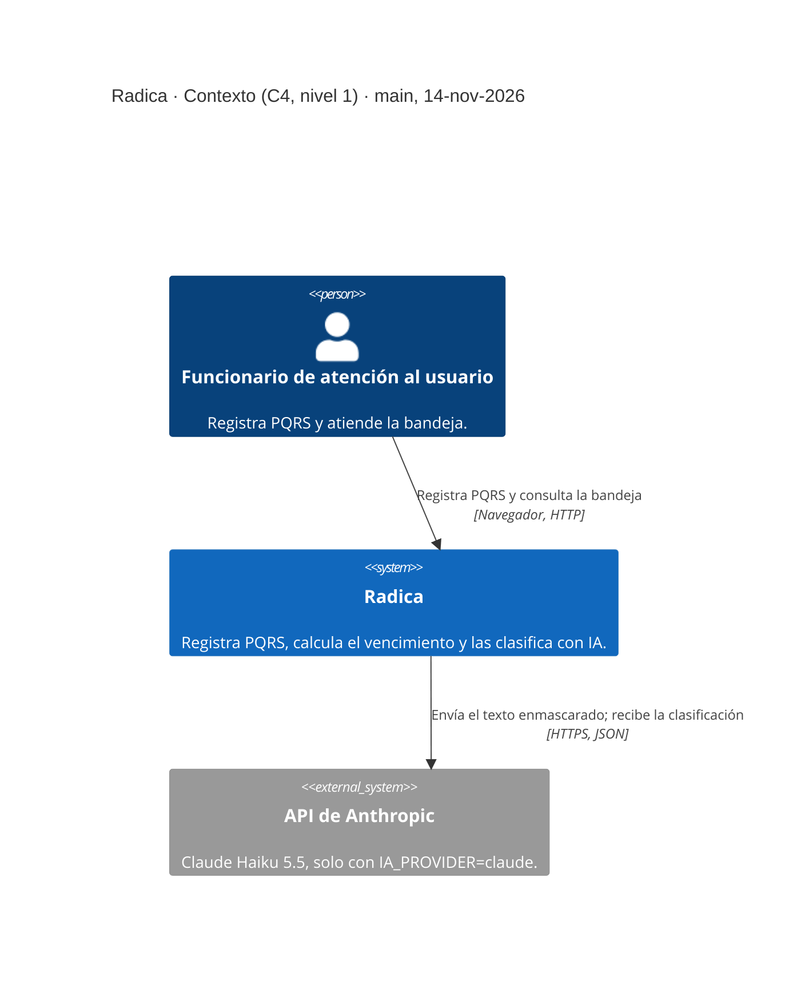
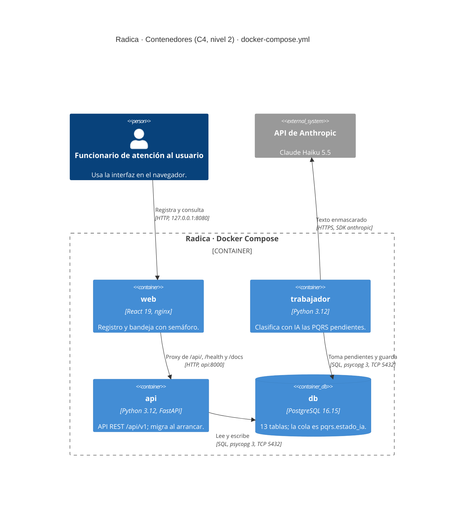

# Arquitectura de Radica

Lo que corre hoy en `main` (14-nov-2026, commit `8e2f5ef`). Los dos diagramas salen del código, no del diseño: `docker-compose.yml`, `Dockerfile`, `web/Dockerfile`, `web/nginx.conf`, `pyproject.toml`, `web/package.json` y la raíz de composición `src/radica/main.py`. Cada elemento de los diagramas existe en esos archivos.

Los `.drawio` y `.png` de [`docs/diseno/`](diseno/) son el diseño de la Entrega 2 y no se actualizan. Lo que el diseño tiene y el código todavía no está en la sección 3.

Actualizado el 18-nov-2026 con el despliegue en Railway (PR #48): los mismos 4 contenedores corren en https://radica-pqrs.up.railway.app (sección 2.1 y [ADR-08](adr/ADR-08-plataforma-de-despliegue.md)).

## 1. Contexto (C4, nivel 1)

| Elemento | Qué hace hoy | Dónde está en el código |
| --- | --- | --- |
| Funcionario de atención al usuario | Usa el formulario de registro y la bandeja. Como no hay autenticación, sus acciones quedan a nombre del usuario semilla «Funcionario Sintético». | `web/src/Registro.tsx`, `web/src/Bandeja.tsx`; `ID_USUARIO_ACTOR` en `src/radica/main.py:54` |
| Radica | El sistema completo: interfaz, API, trabajador y base de datos (sección 2). | `docker-compose.yml` |
| API de Anthropic | Clasifica el texto ya enmascarado. Con `IA_PROVIDER=ninguno` no se llama a nadie y la PQRS pasa a revisión. | `src/radica/adaptadores/salida/ia/claude.py`; `src/radica/config.py:23-26` |

En la Entrega 2, PostgreSQL 16 aparece como sistema externo. En el código es un contenedor de Radica (servicio `db`, `docker-compose.yml:27-28`), por eso está en el nivel 2 y no en este.

## 2. Contenedores (C4, nivel 2)

| Contenedor | Tecnología | Responsabilidad | Dónde está en el código |
| --- | --- | --- | --- |
| `web` | React 19.3.1 y TypeScript 7.0.2, empaquetados con Vite 8.3.5; nginx 1.30.6 sin privilegios | Sirve la interfaz y lleva `/api/`, `/health`, `/docs` y `/openapi.json` a la API en el mismo origen, así que la API no necesita CORS. No tiene lógica de negocio. | `web/package.json`, `web/Dockerfile`, `web/nginx.conf:18-61` |
| `api` | Python 3.12, FastAPI 0.162.0, uvicorn 0.54.0, Pydantic 2.14.2 | Registro, consulta, bandeja, historial, términos y reintento de la IA. Antes de servir corre `alembic upgrade head`. No llama a la IA: su clasificador es el de palabras clave. | `docker-compose.yml:45-61`; `src/radica/main.py:77-118` |
| `trabajador` | La misma imagen que `api`, con el comando `radica-trabajador` | Cada 5 s toma la PQRS pendiente más antigua con `SELECT … FOR UPDATE SKIP LOCKED`, verifica el enmascaramiento y la clasifica con Claude o, si Claude falla, con las palabras clave. | `docker-compose.yml:63-80`; `src/radica/main.py:62-74` y `126-158`; `src/radica/adaptadores/entrada/trabajador/bucle.py`; `src/radica/adaptadores/salida/postgres/repositorios.py:245-251` |
| `db` | PostgreSQL 16.15 (`postgres:16.15-trixie`) | Las 13 tablas del modelo v1.1, creadas por las migraciones de Alembic. | `docker-compose.yml:27-43`; `migraciones/versions/` |

Notas:

- Solo el trabajador habla con Anthropic. La API registra sin esperar a la IA (ADR-04).
- La API también se publica en `127.0.0.1:8000` (Swagger y la colección de Bruno de `api/bruno/`) y la base en `127.0.0.1:5433` (Alembic y las pruebas desde el equipo). Ninguno de los tres puertos sale del equipo: todos están atados a `127.0.0.1`.
- En local no hay HTTPS entre el navegador y `web`, y en ningún entorno hay TLS entre los contenedores y `db`. Ver la sección 3.

### 2.1 Despliegue en Railway

El diagrama vale también para Railway ([ADR-08](adr/ADR-08-plataforma-de-despliegue.md)): un proyecto `radica` con un servicio por contenedor. Lo que cambia es cómo se llega a cada uno:

| Contenedor | En Compose (local) | En Railway |
| --- | --- | --- |
| `web` | `127.0.0.1:8080`, por HTTP | https://radica-pqrs.up.railway.app, el único con dominio público. Railway termina el HTTPS. Se construye con `web/Dockerfile.railway` |
| `api` | `api:8000` en la red de Compose; también `127.0.0.1:8000` | `api.railway.internal:8000`, solo por la red privada. nginx lo resuelve con el DNS interno `[fd12::10]` (variables `RADICA_RESOLVER` y `RADICA_API_URL` de `web/nginx.conf`) |
| `trabajador` | Sin puertos | Sin dominio; sale a la API de Anthropic por HTTPS |
| `db` | `db:5432`; también `127.0.0.1:5433` | `db.railway.internal:5432`, sin puerto público. Los datos van en un volumen |

La configuración de cada servicio (comando, healthcheck, variables y disparadores) está en el README, sección «Despliegue».

## 3. Diferencias con el diseño de la Entrega 2

Lo que aparece en [`docs/diseno/01_contexto_C4.png`](diseno/01_contexto_C4.png) y no existe en el código:

| En el diseño | Qué hay hoy | Lo cubre |
| --- | --- | --- |
| Coordinador(a): consulta vencimientos, carga y temas | No hay tablero ni roles | PB-16 (#21), PB-17 (#24), PB-19 (#22) |
| Coordinador(a): configura términos, festivos, áreas y atributos | Solo lectura de los términos (`GET /api/v1/configuracion/terminos`); los valores llegan por la migración de semillas | RNF-13 (AdministrarConfiguracion, Entrega 2 §5.2); sin issue |
| Funcionario: importa PQRS | Solo el registro de una en una | PB-02 (#3), PB-03 (#25) |
| Funcionario: revisa y corrige la clasificación | No existe `PATCH /pqrs/{id}/clasificacion` | PB-08 (#8) |
| Funcionario: aprueba borradores | No hay borradores | PB-14 (#17), PB-15 (#15) |
| Alertas de riesgo vital en la bandeja | La bandeja muestra el semáforo, sin alertas | PB-12 (#10), en parte |
| Área responsable: recibe la asignación y los recordatorios | `pqrs.id_area` sigue vacío; la API solo muestra el área sugerida | PB-13 (#9), PB-26 (sin issue) |
| Servicio de correo institucional (SMTP) | No hay notificador | PB-26 (sin issue) |
| Hoja de seguimiento de la oficina: reporte semaforizado en CSV | No hay exportación | PB-28 (sin issue) |
| Gemini 3.1 Flash-Lite como proveedor alterno | `IA_PROVIDER` solo admite `claude` o `ninguno` (`src/radica/config.py:23-25`) | ADR-05; sin issue |
| HTTPS entre las personas y Radica | En Railway, por HTTPS en https://radica-pqrs.up.railway.app. En local sigue por HTTP en `127.0.0.1:8080` | PB-25 (#20), resuelto en Railway |
| Conexión cifrada con PostgreSQL | `RADICA_DB_URL` no pide TLS; la base solo está en la red de Compose y en `127.0.0.1` | Sin issue |

## 4. Decisiones

Cada decisión tiene su ADR en [`docs/adr/`](adr/). ADR-01 a ADR-06 vienen de `docs/diseno/entrega-2-arquitectura.md` §8, con los mismos números, y su estado se revisó contra el código el 14-nov-2026.

| ADR | Decisión | Estado hoy |
| --- | --- | --- |
| [ADR-01](adr/ADR-01-monolito-hexagonal.md) | Monolito modular con arquitectura hexagonal y núcleo Clean | Aceptada; 6 puertos en vez de 8 |
| [ADR-02](adr/ADR-02-reglas-deterministas.md) | Plazos, semáforo y nivel de riesgo con reglas deterministas | Aceptada; la política de riesgo se precisó |
| [ADR-03](adr/ADR-03-enmascaramiento-local.md) | Enmascaramiento local obligatorio antes de cualquier llamada externa | Aceptada, sin cambios |
| [ADR-04](adr/ADR-04-clasificacion-en-segundo-plano.md) | Clasificación en segundo plano con cola en la base de datos | Aceptada; trabajador en su propio contenedor y sin tarea programada |
| [ADR-05](adr/ADR-05-proveedor-de-ia.md) | Proveedor de IA: Claude Haiku 5.5, con Gemini como alterno | Provisional, aplicada en parte: sin Gemini |
| [ADR-06](adr/ADR-06-tecnologias.md) | Tecnologías: Python 3.12, FastAPI, SQLAlchemy, PostgreSQL 16 y React con TypeScript | Aceptada el 31-oct-2026 |
| [ADR-07](adr/ADR-07-base-de-datos-postgresql.md) | Base de datos: PostgreSQL 16 | Aceptada el 14-nov-2026; detalla ADR-06 |
| [ADR-08](adr/ADR-08-plataforma-de-despliegue.md) | Plataforma de despliegue: Railway, frente a Render y Fly.io | Aceptada el 18-nov-2026 |
