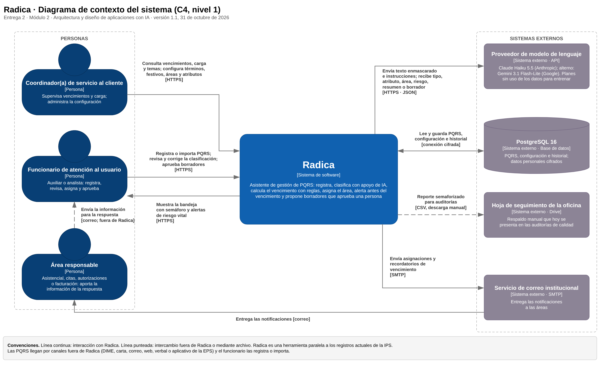
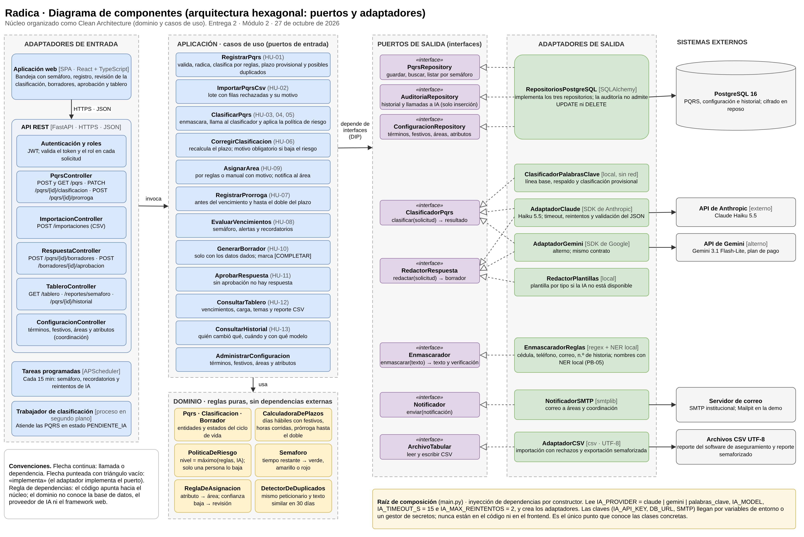
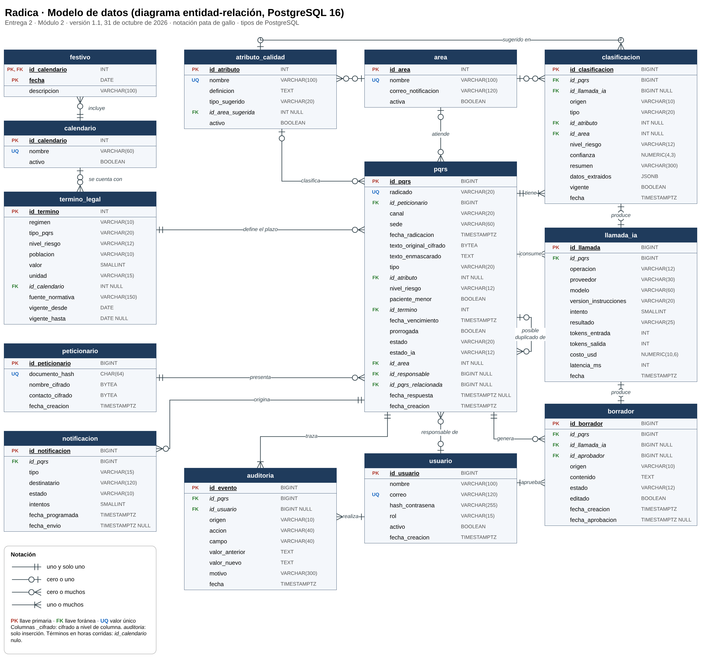
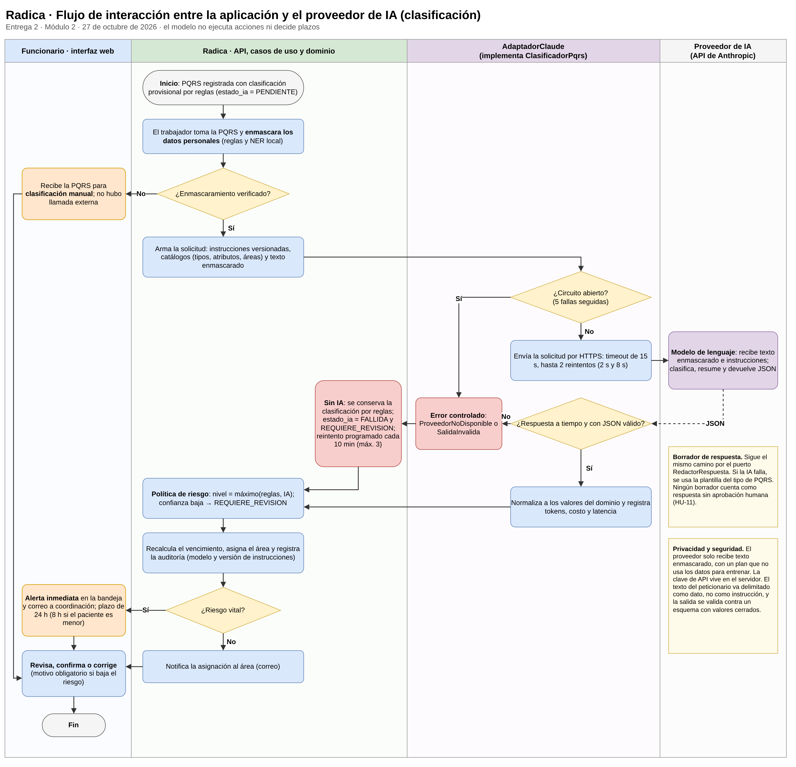

> Copia en texto de la Entrega 2, versión 1.1 (31-oct-2026), convertida del Word entregado. Las figuras son los PNG de esta misma carpeta; los diagramas editables son los .drawio. El cambio de VARCHAR(20) a VARCHAR(25) del tipo de PQRS está en docs/modelo-datos.md.

# Radica · Entrega 2: propuesta arquitectónica

Oct 31, 2026

Esta entrega reúne los siete productos del Módulo 2 para Radica, un asistente de gestión de PQRS, y deja definida la estructura técnica que se implementará en el Módulo 3.

| Dato                     | Detalle                                                                                                                                                                                                                                       |
|--------------------------|-----------------------------------------------------------------------------------------------------------------------------------------------------------------------------------------------------------------------------------------------|
| Programa                 | Diplomado en Ingeniería de Software asistida por Inteligencia Artificial, Universidad Santiago de Cali                                                                                                                                        |
| Módulo                   | 2 · Arquitectura y Diseño de Aplicaciones con IA                                                                                                                                                                                              |
| Proyecto                 | Radica: asistente de gestión de PQRS con plazos legales                                                                                                                                                                                       |
| Equipo                   | Jose Miguel Chávez Figueroa e Isabella Castaño Muñoz                                                                                                                                                                                          |
| Fecha de entrega         | 27 de octubre de 2026                                                                                                                                                                                                                         |
| Versión                  | 1.1, 31 de octubre de 2026: diagrama de contexto y modelo de datos ajustados según las observaciones del docente (secciones 4 y 6)                                                                                                            |
| Archivos complementarios | Diagramas editables 01_contexto_C4.drawio, 02_componentes.drawio, 03_modelo_datos.drawio y 04_flujo_IA.drawio, cada uno con su exportación PNG; especificación de la API radica-api-v0.1.yaml (OpenAPI 3.1, 13 operaciones con ejemplos JSON) |
| Documento base           | Entrega 1: requisitos y plan del proyecto (23 de octubre de 2026) y entrevista V1 con la IPS (26 de octubre de 2026)                                                                                                                          |

**Cómo leer este documento.** Las secciones siguen la estructura de la actividad evaluativa: esta primera página es la portada y las secciones 2 a 12 desarrollan los siete entregables. La sección 11.1 reúne lo que falta validar con usuarios reales.

**Novedad frente a la Entrega 1.** La entrevista con el coordinador de servicio al cliente de la IPS mostró que la mayor parte de la demora está en las áreas. Por eso la arquitectura le da tanto peso al semáforo, a los recordatorios a las áreas y al reporte para auditorías como a la clasificación con IA (sección 2.1).

**Uso de IA en esta entrega.** Los diagramas parten de los borradores de Isabella Castaño (contexto, componentes, flujo y entidad-relación). Se usó Claude (Anthropic) para revisarlos contra el material del módulo y la entrevista, rehacerlos en draw.io y redactar este documento. El equipo revisa cada sección antes de entregarla. Todos los ejemplos usan datos sintéticos.

## 2. Introducción y descripción del proyecto

Radica es un asistente de gestión de PQRS (peticiones, quejas, reclamos y sugerencias) para oficinas de atención al usuario que deben responder dentro de términos legales. El segmento inicial es una IPS de Cali, donde los reclamos de salud tienen plazos más cortos que los del régimen general. Radica registra cada PQRS, la clasifica con apoyo de un modelo de lenguaje, calcula su vencimiento con reglas, la asigna al área responsable, alerta antes de que venza y propone un borrador de respuesta que siempre aprueba una persona.

Este documento retoma los productos del Módulo 1 (visión, 25 ítems de backlog, historias de usuario HU-01 a HU-13 y requisitos no funcionales RNF-01 a RNF-15) y define la estructura técnica del producto mínimo viable (MVP) antes de programarlo en el Módulo 3. No se desarrolla la aplicación: se muestra que puede organizarse en componentes coherentes, mantenibles y preparados para incorporar IA.

### 2.1 Insumos del diseño: entrevista con la IPS

El 26 de octubre de 2026 el equipo entrevistó al coordinador de servicio al cliente de las sedes ambulatorias de la IPS (unos 18 minutos, con transcripción). Sus respuestas cambian varias decisiones respecto de la Entrega 1:

| Hallazgo de la entrevista                                                                                                                                                                          | Consecuencia para la arquitectura                                                                                                                                                                                                                            |
|----------------------------------------------------------------------------------------------------------------------------------------------------------------------------------------------------|--------------------------------------------------------------------------------------------------------------------------------------------------------------------------------------------------------------------------------------------------------------|
| El coordinador estima que el 80 % de la demora está en las áreas y el 20 % en la oficina. Las áreas tardan de dos o tres días hasta más de un mes en responder.                                    | El seguimiento pasa al centro del diseño: semáforo, alertas y recordatorios por correo a las áreas (casos de uso EvaluarVencimientos y AsignarArea; adaptador NotificadorSMTP). La clasificación con IA se mantiene, pero no es el único valor del producto. |
| El software de aseguramiento no tiene semáforo, su campo de tipo de respuesta está desactualizado y a veces pierde registros o cambia fechas. Esto ha generado hallazgos en auditorías de calidad. | Radica funciona en paralelo: importa el reporte que la oficina ya descarga (CSV) y exporta un reporte semaforizado para las auditorías. No modifica ese software ni se integra en vivo con él.                                                               |
| La oficina clasifica por «atributo», cada uno con su definición y su tiempo de respuesta; por ejemplo, un asunto de calidad humana suele ser una queja con 15 días hábiles.                        | Se agrega la entidad atributo_calidad, configurable. La IA sugiere el atributo y las reglas derivan el tipo, el área y el plazo. El catálogo real se solicitará a la IPS.                                                                                    |
| El coordinador nombró «vital, priorizado o general» como la clasificación vigente para responder, aunque no habló de plazos en horas.                                                              | Se mantienen los niveles de riesgo en la tabla de términos. Queda por confirmar si la oficina controla los reclamos en horas (hipótesis S3).                                                                                                                 |
| Llegan PQRS duplicadas: una por el aplicativo de la EPS y otra en la oficina, por el mismo motivo; se responde una y se olvida la otra.                                                            | Nueva regla DetectorDeDuplicados (mismo peticionario y texto similar) y relación de posible duplicado en el modelo de datos.                                                                                                                                 |
| Volumen: unas 90 a 100 PQRS al mes en la sede clínica y unas 250 al mes en otra sede que todavía no las registra en el software.                                                                   | Volumen bajo: basta un monolito modular sin colas externas, y el costo de la IA es marginal (sección 9.9).                                                                                                                                                   |
| Solo dos personas de la oficina pueden consultar la historia clínica, en modo de lectura.                                                                                                          | Radica no se integra con la historia clínica. Los datos del peticionario se guardan cifrados y separados del texto.                                                                                                                                          |
| Lo que más cambiaría el coordinador: que al registrar la PQRS se llene solo el tiempo de respuesta.                                                                                                | Eso lo resuelve la CalculadoraDePlazos con reglas, no la IA.                                                                                                                                                                                                 |

De la entrevista salen tres ítems nuevos para el backlog, con prioridad propuesta: **PB-26** Notificar asignaciones y recordatorios a las áreas por correo (Debe tener); **PB-27** Detectar posibles duplicados (Debería tener); **PB-28** Exportar el reporte semaforizado para auditorías (Debe tener). Siguen pendientes la línea base de vencimientos, el catálogo de atributos y las condiciones de jurídica para enviar texto a un proveedor de IA (sección 11.1).

### 2.2 Alcance de esta propuesta

La arquitectura cubre el MVP de la Entrega 1: registro e importación, enmascaramiento de datos personales, clasificación asistida, cálculo de plazos, semáforo, asignación, borrador con aprobación, tablero y auditoría, más los tres ítems anteriores. Quedan fuera la lectura de correo entrante, WhatsApp, la integración en vivo con el software de aseguramiento, la historia clínica, el envío y la firma de respuestas y el uso de PQRS reales. La IPS no se nombra porque aún no se tiene su autorización escrita.

## 3. Objetivo de la propuesta arquitectónica

**Objetivo general.** Definir una arquitectura para el MVP de Radica que mantenga las reglas de plazos y de riesgo aisladas y verificables, permita cambiar el proveedor de IA sin modificar el núcleo y siga registrando y alertando cuando la IA falla.

**Objetivos específicos.**

1.  Aislar el cálculo de plazos, el semáforo y la política de riesgo en un dominio sin dependencias externas, que se pueda probar sin red ni base de datos.

2.  Garantizar que ningún dato personal salga hacia el proveedor de IA y que, si el enmascaramiento falla, no haya llamada externa.

3.  Desacoplar el proveedor de IA mediante puertos, de modo que cambiarlo solo exija un adaptador y configuración.

4.  Mantener el registro, los plazos y las alertas aunque el proveedor no responda.

5.  Registrar quién o qué decidió cada clasificación, plazo y aprobación.

6.  Encajar con la operación real de la oficina: herramienta paralela, archivos CSV y correo.

### 3.1 Requisitos que condicionan la arquitectura

No todos los requisitos pesan igual en el diseño. Estos son los que deciden la estructura:

| Requisito      | Qué exige                                                                 | Cómo lo atiende la arquitectura                                                                                        |
|----------------|---------------------------------------------------------------------------|------------------------------------------------------------------------------------------------------------------------|
| RNF-01, RNF-02 | Ningún dato personal hacia la IA; sin llamada si el enmascaramiento falla | Puerto Enmascarador invocado por el caso de uso antes del puerto ClasificadorPqrs, con verificación posterior (ADR-03) |
| RNF-07         | La IA nunca baja el riesgo ni el plazo                                    | PoliticaDeRiesgo en el dominio: nivel = máximo(reglas, IA); solo una persona lo baja, con motivo                       |
| RNF-09, RNF-13 | Plazos 100 % correctos y configurables sin cambiar código                 | CalculadoraDePlazos pura y tablas termino_legal, calendario y festivo (ADR-02)                                         |
| RNF-10         | Si la IA falla o tarda, la PQRS queda registrada con su plazo             | Registro sin IA, clasificación provisional por reglas y cola en la base de datos (ADR-04)                              |
| RNF-11         | Clasificación con percentil 95 menor a 15 s                               | Timeout de 15 s por intento y procesamiento en segundo plano                                                           |
| RNF-14         | Proveedor de IA reemplazable                                              | Puertos ClasificadorPqrs y RedactorRespuesta con dos adaptadores reales (ADR-05 y sección 10)                          |
| RNF-06         | Trazabilidad que no se pueda editar                                       | Tabla auditoria de solo inserción y registro de cada llamada a la IA                                                   |
| RNF-04, RNF-05 | Secretos fuera del código; cifrado en tránsito y en reposo                | Variables de entorno o gestor de secretos; HTTPS; columnas cifradas                                                    |
| RNF-15         | Entrada y salida en CSV UTF-8                                             | Puerto ArchivoTabular y AdaptadorCSV                                                                                   |

## 4. Diagrama de contexto y explicación

La figura 1 muestra Radica como una sola unidad (modelo C4, nivel 1), con las personas que la usan y los sistemas externos con los que intercambia información.

*Figura 1. Diagrama de contexto del sistema (C4, nivel 1). Archivo editable: 01_contexto_C4.drawio.*

El diagrama parte del borrador de Isabella Castaño, agrega lo que mostró la entrevista (las áreas reciben recordatorios por correo y la hoja de seguimiento de la oficina recibe el reporte semaforizado) y corrige el recuadro del proveedor de IA, que repetía la descripción de Radica. La versión 1.1 atiende las observaciones del docente: retira al peticionario, que no interactúa con Radica; retira el software de aseguramiento de la IPS, porque implementar Radica en esa institución es una opción a futuro y no un compromiso del diplomado; y agrega la base de datos PostgreSQL 16.

### 4.1 Actores y sistemas externos

| Elemento                              | Tipo                            | Relación con Radica                                                                                                                                                       |
|---------------------------------------|---------------------------------|---------------------------------------------------------------------------------------------------------------------------------------------------------------------------|
| Coordinador(a) de servicio al cliente | Persona (usuario secundario)    | Consulta vencimientos, carga por persona y temas; administra términos, festivos, áreas y atributos.                                                                       |
| Funcionario de atención al usuario    | Persona (usuario principal)     | Registra o importa PQRS, revisa y corrige la clasificación, aprueba borradores y atiende la bandeja con semáforo.                                                         |
| Área responsable                      | Persona                         | Recibe la asignación y los recordatorios por correo y entrega la información por correo, como hoy. En el MVP no inicia sesión en Radica.                                  |
| Proveedor de modelo de lenguaje       | Sistema externo                 | Recibe texto enmascarado e instrucciones y devuelve una clasificación o un borrador en JSON.                                                                              |
| PostgreSQL 16                         | Sistema externo (base de datos) | Guarda las PQRS, la configuración y el historial. Radica lee y escribe por una conexión cifrada; los datos personales llegan ya cifrados por la aplicación (sección 6.3). |
| Hoja de seguimiento de la oficina     | Sistema externo                 | Respaldo manual que hoy se presenta en auditorías; recibe el reporte semaforizado que exporta Radica.                                                                     |
| Servicio de correo institucional      | Sistema externo                 | Entrega a las áreas las notificaciones que Radica envía por SMTP.                                                                                                         |

### 4.2 Funcionamiento general

Una PQRS llega por cualquier canal y el funcionario la registra en Radica, o carga en lote un archivo CSV con varias PQRS. Radica le asigna un radicado, aplica una clasificación provisional por reglas y calcula un vencimiento provisional. Después, en segundo plano, enmascara los datos personales y pide al proveedor de IA el tipo, el atributo, el área sugerida, el nivel de riesgo y un resumen. Con esa sugerencia, las reglas recalculan el plazo y asignan el área, y Radica envía la asignación al área por correo.

Mientras la PQRS está abierta, una tarea programada evalúa el semáforo y envía recordatorios. Cuando el área entrega la información, el funcionario pide un borrador, lo edita y lo aprueba; la respuesta se notifica al peticionario por fuera de Radica, como hoy. La coordinación consulta el tablero y exporta el reporte semaforizado para las auditorías.

> **Límite del sistema.** Radica no envía respuestas al peticionario, no lee correo entrante ni se integra con los sistemas de la IPS: las PQRS llegan por los canales actuales y el funcionario las registra o importa. Por eso el peticionario no aparece en la figura 1. La línea punteada marca los intercambios que ocurren fuera de Radica o mediante archivo.

## 5. Diagrama de componentes y justificación

La figura 2 descompone Radica con arquitectura hexagonal (puertos y adaptadores); el núcleo se organiza como en Clean Architecture.

*Figura 2. Diagrama de componentes y arquitectura propuesta. Archivo editable: 02_componentes.drawio.*

El núcleo tiene un dominio con reglas puras y una capa de aplicación con un caso de uso por cada intención del usuario. El diagrama conserva la estructura del borrador de Isabella y agrega los puertos de notificación, auditoría y configuración, las tareas programadas, el trabajador de clasificación, el detector de duplicados y la raíz de composición.

### 5.1 Responsabilidades por grupo

| Grupo                  | Componentes                                                                                                             | Responsabilidad                                                                                                                             | Depende de                                              |
|------------------------|-------------------------------------------------------------------------------------------------------------------------|---------------------------------------------------------------------------------------------------------------------------------------------|---------------------------------------------------------|
| Adaptadores de entrada | Aplicación web (SPA), API REST con seis controladores, tareas programadas y trabajador de clasificación                 | Recibir solicitudes HTTP o eventos de tiempo, validar formato y rol y llamar a un caso de uso. No contienen reglas de negocio ni SQL.       | Casos de uso                                            |
| Aplicación             | 12 casos de uso (HU-01 a HU-13 y configuración)                                                                         | Coordinar una intención del usuario: obtener datos por los puertos, aplicar las reglas del dominio y guardar el resultado con su auditoría. | Dominio y puertos de salida                             |
| Dominio                | Pqrs, Clasificacion, Borrador; CalculadoraDePlazos, PoliticaDeRiesgo, Semaforo, ReglaDeAsignacion, DetectorDeDuplicados | Reglas y estados del negocio, en código puro, sin librerías de infraestructura.                                                             | Nada externo                                            |
| Puertos de salida      | Ocho interfaces                                                                                                         | Expresar en términos del dominio lo que el núcleo necesita del exterior.                                                                    | Tipos del dominio                                       |
| Adaptadores de salida  | PostgreSQL, Claude, Gemini, palabras clave, plantillas, enmascarador, SMTP y CSV                                        | Implementar un puerto con una tecnología concreta y traducir sus errores a errores del dominio.                                             | Puertos y librerías externas                            |
| Raíz de composición    | main.py                                                                                                                 | Leer la configuración y conectar cada puerto con su adaptador.                                                                              | Todo; es el único punto que conoce las clases concretas |

### 5.2 Casos de uso y puntos de entrada

| Caso de uso              | Origen              | Se invoca desde                                                                 |
|--------------------------|---------------------|---------------------------------------------------------------------------------|
| RegistrarPqrs            | HU-01               | POST /pqrs (PqrsController)                                                     |
| ImportarPqrsCsv          | HU-02               | POST /importaciones (ImportacionController)                                     |
| ClasificarPqrs           | HU-03, HU-04, HU-05 | Trabajador de clasificación; POST /pqrs/{id}/clasificaciones para reintentar    |
| CorregirClasificacion    | HU-06               | PATCH /pqrs/{id}/clasificacion                                                  |
| AsignarArea              | HU-09               | Al terminar la clasificación; cambio manual por PATCH /pqrs/{id}/clasificacion  |
| RegistrarProrroga        | HU-07               | POST /pqrs/{id}/prorroga                                                        |
| EvaluarVencimientos      | HU-08, PB-26        | Tareas programadas cada 15 minutos; la bandeja (GET /pqrs) muestra el resultado |
| GenerarBorrador          | HU-10               | POST /pqrs/{id}/borradores (RespuestaController)                                |
| AprobarRespuesta         | HU-11               | POST /borradores/{id}/aprobacion                                                |
| ConsultarTablero         | HU-12, PB-28        | GET /tablero y GET /reportes/semaforo (TableroController)                       |
| ConsultarHistorial       | HU-13               | GET /pqrs/{id}/historial                                                        |
| AdministrarConfiguracion | RNF-13              | Rutas /configuracion (ConfiguracionController)                                  |

### 5.3 Interfaces (puertos de salida)

| Puerto                  | Operaciones principales                                                   | Implementaciones                                            |
|-------------------------|---------------------------------------------------------------------------|-------------------------------------------------------------|
| PqrsRepository          | guardar(pqrs), obtener(id), listar(filtro), pendientes_de_ia(límite)      | RepositoriosPostgreSQL                                      |
| AuditoriaRepository     | registrar(evento), registrar_llamada_ia(uso), historial(id)               | RepositoriosPostgreSQL                                      |
| ConfiguracionRepository | terminos_vigentes(fecha), festivos(calendario, año), areas(), atributos() | RepositoriosPostgreSQL                                      |
| ClasificadorPqrs        | clasificar(SolicitudClasificacion) → ResultadoClasificacion               | AdaptadorClaude, AdaptadorGemini, ClasificadorPalabrasClave |
| RedactorRespuesta       | redactar(SolicitudBorrador) → ResultadoBorrador                           | AdaptadorClaude, AdaptadorGemini, RedactorPlantillas        |
| Enmascarador            | enmascarar(texto) → texto enmascarado, marcadores y verificación          | EnmascaradorReglas                                          |
| Notificador             | enviar(notificacion)                                                      | NotificadorSMTP                                             |
| ArchivoTabular          | leer_pqrs(archivo) → filas y rechazos; escribir_reporte(filas)            | AdaptadorCSV                                                |

Los puertos se declaran dentro del núcleo; los adaptadores dependen de ellos y no al revés. Por eso la figura 2 dibuja las flechas «implementa» desde los adaptadores hacia los puertos, mientras la ejecución va en sentido contrario.

### 5.4 Justificación del enfoque

Se eligió arquitectura hexagonal con núcleo Clean en un monolito modular (ADR-01). Los tres enfoques vistos en clase se comparan así para Radica:

| Enfoque                              | A favor en Radica                                                                                 | En contra en Radica                                                                                                                                                  |
|--------------------------------------|---------------------------------------------------------------------------------------------------|----------------------------------------------------------------------------------------------------------------------------------------------------------------------|
| Capas (controlador → servicio → DAO) | Sencillo y conocido; menos archivos.                                                              | El servicio terminaría importando el SDK de IA y el DAO concreto: no se podrían probar los plazos sin infraestructura ni cambiar de proveedor sin tocar el servicio. |
| Clean Architecture                   | Reglas en el centro y dependencias hacia adentro.                                                 | Por sí sola no indica cómo conectar las varias entradas y salidas (web, CSV, correo, tareas, dos proveedores de IA).                                                 |
| Hexagonal (puertos y adaptadores)    | Cada entrada y salida es un adaptador intercambiable; el núcleo se prueba con adaptadores falsos. | Más interfaces que un CRUD; exige no crear puertos innecesarios.                                                                                                     |

La combinación toma de Clean Architecture la organización del núcleo (entidades y casos de uso) y de la arquitectura hexagonal la forma de conectarlo con el exterior. Se descartaron los microservicios: dos personas, seis semanas y unas 350 PQRS al mes no justifican varios despliegues ni comunicación por red entre servicios.

### 5.5 Preguntas de diseño

- **¿Qué requisito justifica cada componente?** Cada caso de uso corresponde a una historia de usuario; cada puerto, a un requisito de la tabla 3.1; las tareas programadas, a HU-08 y RNF-10; el notificador y el detector de duplicados, a la entrevista.

- **¿Dónde está el mayor acoplamiento?** Entre ClasificarPqrs y el formato de las instrucciones y catálogos que se envían al modelo: si cambian los tipos o los atributos, cambian las instrucciones. Se mitiga versionando las instrucciones y generando el catálogo desde la base de datos. El segundo punto es el esquema de PostgreSQL, encapsulado en RepositoriosPostgreSQL.

- **¿Qué cambia si se sustituye el proveedor de IA?** Un adaptador y la configuración (sección 10).

## 6. Modelo de datos

La figura 3 presenta el modelo relacional del MVP en PostgreSQL 16: 13 tablas con sus llaves, tipos y cardinalidades en notación de pata de gallo.

*Figura 3. Modelo de datos (diagrama entidad-relación). Archivo editable: 03_modelo_datos.drawio.*

El modelo amplía el diagrama de Isabella con los tipos de datos, la tabla de festivos, el catálogo de atributos, los datos del peticionario separados y cifrados, las notificaciones y la relación de posibles duplicados. En la versión 1.1 ninguna tabla queda aislada, como pidió el docente: calendario agrupa los festivos y cada término en días hábiles indica con qué calendario se cuenta.

### 6.1 Entidades

| Tabla            | Qué guarda                                                                  | Atributos clave                                                                                                                |
|------------------|-----------------------------------------------------------------------------|--------------------------------------------------------------------------------------------------------------------------------|
| pqrs             | Cada solicitud y su estado actual                                           | radicado (único), canal, fecha_radicacion, texto_enmascarado, tipo, nivel_riesgo, fecha_vencimiento, estado, estado_ia         |
| peticionario     | Quién presenta la PQRS                                                      | documento_hash, para detectar duplicados sin guardar el documento en claro; nombre y contacto cifrados                         |
| clasificacion    | Historial de sugerencias y decisiones: por reglas, por IA o por una persona | origen, tipo, atributo, área, nivel_riesgo, confianza, resumen, vigente                                                        |
| llamada_ia       | Cada llamada al proveedor, incluidos los fallos                             | proveedor, modelo, version_instrucciones, resultado, tokens, costo_usd, latencia_ms                                            |
| borrador         | Borradores y su aprobación                                                  | origen (IA o plantilla), contenido, estado, editado, id_aprobador, fecha_aprobacion                                            |
| auditoria        | Quién cambió qué y cuándo                                                   | origen (persona, IA o sistema), accion, campo, valor_anterior, valor_nuevo, motivo                                             |
| notificacion     | Correos programados y enviados                                              | tipo (asignación, recordatorio, vencida, riesgo vital), destinatario, estado, intentos                                         |
| area             | Áreas responsables                                                          | nombre, correo_notificacion                                                                                                    |
| atributo_calidad | Catálogo de atributos de la IPS                                             | nombre, definicion, tipo_sugerido, área sugerida                                                                               |
| termino_legal    | Tabla de términos configurable                                              | regimen, tipo_pqrs, nivel_riesgo, poblacion, valor, unidad, id_calendario (nulo en horas corridas), fuente_normativa, vigencia |
| calendario       | Calendarios de días hábiles; en el MVP, solo el nacional de Colombia        | nombre (único), activo                                                                                                         |
| festivo          | Fechas no hábiles de cada calendario                                        | id_calendario y fecha (llave compuesta), descripcion                                                                           |
| usuario          | Funcionarios, coordinación y administración                                 | correo (único), rol, activo                                                                                                    |

### 6.2 Relaciones y cardinalidades

| Relación                                           | Cardinalidad | Regla                                                                                                  |
|----------------------------------------------------|--------------|--------------------------------------------------------------------------------------------------------|
| peticionario – pqrs                                | 1 : 0..N     | Toda PQRS tiene un peticionario; un peticionario puede tener varias.                                   |
| termino_legal – pqrs                               | 1 : 0..N     | Cada PQRS guarda el término que se le aplicó, para auditar el cálculo.                                 |
| calendario – festivo                               | 1 : 0..N     | Cada festivo pertenece a un calendario; la llave de festivo es (id_calendario, fecha).                 |
| calendario – termino_legal                         | 0..1 : 0..N  | Los términos en días hábiles se cuentan con su calendario; los de horas corridas no tienen calendario. |
| area – pqrs                                        | 0..1 : 0..N  | Una PQRS sin clasificar aún no tiene área.                                                             |
| atributo_calidad – pqrs                            | 0..1 : 0..N  | El atributo puede faltar si la clasificación es manual.                                                |
| usuario – pqrs                                     | 0..1 : 0..N  | Responsable asignado.                                                                                  |
| pqrs – pqrs                                        | 0..1 : 0..N  | id_pqrs_relacionada marca un posible duplicado.                                                        |
| pqrs – clasificacion                               | 1 : 1..N     | Siempre existe al menos la clasificación por reglas; solo una es vigente.                              |
| pqrs – llamada_ia                                  | 1 : 0..N     | Incluye los reintentos fallidos.                                                                       |
| llamada_ia – clasificacion y llamada_ia – borrador | 0..1 : 0..1  | Liga cada sugerencia de la IA con la llamada que la produjo.                                           |
| pqrs – borrador                                    | 1 : 0..N     | Solo uno puede quedar aprobado.                                                                        |
| usuario – borrador                                 | 0..1 : 0..N  | Quién aprobó.                                                                                          |
| pqrs – auditoria                                   | 1 : 1..N     | El registro de la PQRS ya es el primer evento.                                                         |
| usuario – auditoria                                | 0..1 : 0..N  | Los eventos del sistema o de la IA no tienen usuario.                                                  |
| pqrs – notificacion                                | 1 : 0..N     | Un correo por tipo y fecha programada.                                                                 |
| area – atributo_calidad y area – clasificacion     | 0..1 : 0..N  | Área sugerida.                                                                                         |

### 6.3 Almacenamiento de la información

- **Motor relacional.** PostgreSQL 16, porque los datos son estructurados, las relaciones requieren integridad referencial y el tablero consulta por fecha, área y estado. Los datos semiestructurados que devuelve la IA (datos_extraidos) se guardan en una columna JSONB, sin otra base de datos.

- **Fechas.** TIMESTAMPTZ con la zona America/Bogota, necesaria para los plazos en horas corridas. Los días hábiles se cuentan con los festivos del calendario que indica cada término; los términos en horas corridas no usan calendario.

- **Datos personales.** El nombre y el contacto del peticionario y el texto original se cifran en la aplicación (AES-256-GCM), con una llave que se guarda fuera de la base de datos. La bandeja y la IA trabajan con texto_enmascarado. documento_hash es un HMAC-SHA-256 del documento, que permite detectar duplicados sin guardarlo en claro.

- **Valores derivados.** pqrs repite el tipo, el nivel de riesgo, el área y la fecha de vencimiento vigentes para que la bandeja y el semáforo no recalculen sobre el historial. Es una desnormalización justificada: cada cambio se registra en auditoria y la clasificación vigente queda en clasificacion.

- **Integridad.** Llaves foráneas con ON DELETE RESTRICT, de modo que nada se borra en cascada; restricciones CHECK para los valores cerrados (tipo, nivel_riesgo, estado, origen). A la tabla auditoria el usuario de la aplicación solo puede insertar: se le revocan UPDATE y DELETE.

- **Índices.** pqrs(fecha_vencimiento) para las PQRS abiertas, pqrs(estado_ia), pqrs(id_area), clasificacion(id_pqrs, vigente), auditoria(id_pqrs, fecha) y el índice único de peticionario(documento_hash).

- **Configuración como datos.** Términos, calendarios, festivos, áreas y atributos son filas, no código (RNF-13). La tabla 6.4 muestra los valores iniciales.

- **Retención.** Por definir con jurídica (V4). El proyecto solo usa datos sintéticos.

### 6.4 Valores iniciales de la tabla de términos

| Régimen | Tipo                                  | Nivel de riesgo | Plazo             | Fuente                                                                       |
|---------|---------------------------------------|-----------------|-------------------|------------------------------------------------------------------------------|
| General | Petición                              | —               | 15 días hábiles   | Ley 1755 de 2015, art. 14                                                    |
| General | Solicitud de información o documentos | —               | 10 días hábiles   | Ley 1755 de 2015, art. 14                                                    |
| General | Consulta                              | —               | 30 días hábiles   | Ley 1755 de 2015, art. 14                                                    |
| General | Queja y sugerencia                    | —               | 15 días hábiles   | Ley 1755 de 2015, art. 14, y entrevista V1 (confirmar con jurídica)          |
| Salud   | Reclamo                               | Simple          | 72 horas corridas | Supersalud, Circular Externa 2023151000000010-5 (Concepto 20231600001323481) |
| Salud   | Reclamo                               | Priorizado      | 48 horas corridas | Ídem                                                                         |
| Salud   | Reclamo                               | Vital           | 24 horas corridas | Ídem                                                                         |
| Salud   | Reclamo de un paciente menor de edad  | Vital           | 8 horas           | Supersalud, Circular Externa 2026151000000007-5                              |

La regla de conteo (desde el día hábil siguiente a la radicación) y la hora de cierre del último día (23:59) son supuestos del equipo que se confirman con la coordinación y con jurídica (V3 y V4).

## 7. Especificación de API

La API REST conecta la aplicación web con el backend. Los contratos completos de las 13 operaciones están en el archivo complementario radica-api-v0.1.yaml (OpenAPI 3.1, validado con openapi-spec-validator). Esta sección detalla cuatro operaciones representativas.

### 7.1 Convenciones

- Ruta base /api/v1; JSON UTF-8 con nombres en camelCase; fechas ISO 8601 con zona horaria (−05:00).

- Autenticación con token JWT en la cabecera Authorization: Bearer. Roles: FUNCIONARIO, COORDINADOR y ADMIN.

- Errores en formato Problem Details (RFC 9457), con tipo de contenido application/problem+json.

- Códigos: 200 consulta o actualización correcta; 201 recurso creado; 202 solicitud aceptada para proceso en segundo plano; 400 datos inválidos; 401 sin autenticar; 403 rol sin permiso; 404 no existe; 409 el estado no permite la operación; 422 regla de negocio incumplida.

- La API nunca expone el proveedor de IA, las instrucciones ni las claves; solo el modelo y la versión de instrucciones, para la trazabilidad.

### 7.2 Resumen de endpoints

| Método | Ruta                        | Propósito                                             | Origen        |
|--------|-----------------------------|-------------------------------------------------------|---------------|
| POST   | /pqrs                       | Registrar una PQRS                                    | HU-01         |
| GET    | /pqrs                       | Bandeja con filtros por semáforo, estado, área y tipo | HU-08         |
| GET    | /pqrs/{id}                  | Consultar una PQRS con su clasificación y vencimiento | HU-04, HU-07  |
| PATCH  | /pqrs/{id}/clasificacion    | Corregir la clasificación                             | HU-06         |
| POST   | /pqrs/{id}/clasificaciones  | Pedir de nuevo la clasificación con IA (202)          | HU-04         |
| POST   | /pqrs/{id}/prorroga         | Registrar la prórroga                                 | HU-07         |
| GET    | /pqrs/{id}/historial        | Trazabilidad completa                                 | HU-13         |
| POST   | /pqrs/{id}/borradores       | Generar un borrador de respuesta                      | HU-10         |
| POST   | /borradores/{id}/aprobacion | Aprobar la respuesta                                  | HU-11         |
| POST   | /importaciones              | Importar PQRS desde CSV                               | HU-02         |
| GET    | /tablero                    | Indicadores de la coordinación                        | HU-12         |
| GET    | /reportes/semaforo          | Reporte semaforizado en CSV                           | Entrevista V1 |
| GET    | /configuracion/terminos     | Tabla de términos vigente                             | RNF-13        |

### 7.3 POST /api/v1/pqrs · Registrar una PQRS

**Propósito.** Registrar la PQRS, asignarle radicado, aplicar la clasificación provisional por reglas y calcular el vencimiento provisional. No espera a la IA: la clasificación con IA queda pendiente (ADR-04). **Rol:** FUNCIONARIO.

**Cuerpo de la solicitud**

| Campo               | Tipo                                                             | Oblig. | Descripción                                               |
|---------------------|------------------------------------------------------------------|--------|-----------------------------------------------------------|
| canal               | texto: DIME, CARTA, CORREO, WEB, VERBAL, BUZON, APLICATIVO_EPS   | Sí     | Medio por el que llegó                                    |
| sede                | texto                                                            | No     | Sede donde se recibió                                     |
| fechaRadicacion     | fecha y hora ISO 8601                                            | Sí     | Inicio del conteo del plazo                               |
| texto               | texto de 10 a 10.000 caracteres                                  | Sí     | Contenido de la PQRS tal como la escribió el peticionario |
| pacienteMenorDeEdad | booleano                                                         | No     | Activa el término de 8 horas para riesgo vital            |
| peticionario        | objeto: tipoDocumento, numeroDocumento, nombre, telefono, correo | Sí     | Se guarda cifrado; nunca se envía a la IA                 |

{  
"canal": "DIME",  
"sede": "Sede clínica",  
"fechaRadicacion": "2026-10-30T16:00:00-05:00",  
"texto": "Desde hace tres semanas me ordenaron una resonancia y no me han dado la autorización...",  
"pacienteMenorDeEdad": false,  
"peticionario": {  
"tipoDocumento": "CC", "numeroDocumento": "1000000001",  
"nombre": "Usuario Sintético Uno", "telefono": "3000000000",  
"correo": "usuario1@ejemplo.com"  
}  
}

**Respuesta: 201 Created**, con la cabecera Location: /api/v1/pqrs/1287

{  
"id": 1287,  
"radicado": "RAD-2026-001287",  
"estado": "REGISTRADA",  
"estadoIa": "PENDIENTE",  
"clasificacionProvisional": {  
"origen": "REGLAS", "tipo": "RECLAMO", "nivelRiesgo": "SIMPLE",  
"area": { "id": 4, "nombre": "Autorizaciones" }  
},  
"vencimiento": {  
"fecha": "2026-11-02T16:00:00-05:00",  
"regla": "Reclamo en salud, riesgo simple: 72 horas corridas",  
"semaforo": "VERDE"  
},  
"posiblesDuplicados": \[\]  
}

El vencimiento cuenta 72 horas corridas aunque el 2 de noviembre sea festivo, como en el criterio de aceptación de HU-07. **Errores:** 400 si falta un campo obligatorio o la fecha no tiene formato válido; 401 sin token; 403 si el rol no es FUNCIONARIO.

**Ejemplo de error: 400 Bad Request** (application/problem+json)

{  
"type": "https://radica.local/problemas/validacion",  
"title": "Datos inválidos",  
"status": 400,  
"detail": "La solicitud tiene 2 errores de validación.",  
"instance": "/api/v1/pqrs",  
"errores": \[  
{ "campo": "texto", "mensaje": "El texto es obligatorio." },  
{ "campo": "fechaRadicacion", "mensaje": "Debe ser una fecha ISO 8601 con zona horaria." }  
\]  
}

### 7.4 GET /api/v1/pqrs/{id} · Consultar una PQRS

**Propósito.** Mostrar al funcionario la clasificación vigente, su origen y el vencimiento con el semáforo. **Parámetro:** id, en la ruta (entero). **Rol:** FUNCIONARIO o COORDINADOR. En este ejemplo la IA subió el riesgo de simple a priorizado, de modo que el plazo pasó de 72 a 48 horas; nunca podría haberlo bajado.

**Respuesta: 200 OK**

{  
"id": 1287,  
"radicado": "RAD-2026-001287",  
"textoEnmascarado": "Desde hace tres semanas me ordenaron una resonancia ... \[TELEFONO_1\].",  
"estado": "ASIGNADA",  
"estadoIa": "COMPLETADA",  
"clasificacion": {  
"origen": "IA", "tipo": "RECLAMO",  
"atributo": { "id": 2, "nombre": "Oportunidad" },  
"area": { "id": 4, "nombre": "Autorizaciones" },  
"nivelRiesgo": "PRIORIZADO", "confianza": 0.86, "requiereRevision": false,  
"resumen": "Paciente espera hace tres semanas la autorización de una resonancia.",  
"modelo": "claude-haiku-5-5", "versionInstrucciones": "clasif-v1.0"  
},  
"vencimiento": {  
"fecha": "2026-11-01T16:00:00-05:00",  
"regla": "Reclamo en salud, riesgo priorizado: 48 horas corridas",  
"semaforo": "AMARILLO", "horasRestantes": 20.5  
},  
"responsable": { "id": 7, "nombre": "Funcionario Sintético" },  
"posiblesDuplicados": \[\]  
}

**Errores:** 401 sin token; 404 si la PQRS no existe. El atributo «Oportunidad» es un ejemplo: el catálogo real se pedirá a la IPS.

### 7.5 PATCH /api/v1/pqrs/{id}/clasificacion · Corregir la clasificación

**Propósito.** Que una persona corrija el tipo, el atributo, el área o el nivel de riesgo. El vencimiento se recalcula con la tabla de términos y el cambio queda en la auditoría con el valor anterior (HU-06). Bajar el nivel de riesgo exige un motivo. **Rol:** FUNCIONARIO o COORDINADOR.

En el ejemplo, una PQRS radicada el viernes 30 de octubre de 2026 pasa de petición a solicitud de información. Con 15 días hábiles vencía el 24 de noviembre; con 10, vence el 17 de noviembre, porque el 2 y el 16 de noviembre son festivos.

**Cuerpo de la solicitud**

{  
"tipo": "SOLICITUD_INFORMACION",  
"nivelRiesgo": "NO_APLICA",  
"idArea": 3,  
"motivo": "El peticionario solo pide copia de documentos; aplica el término de información."  
}

**Respuesta: 200 OK**

{  
"id": 1290,  
"clasificacion": {  
"origen": "PERSONA", "tipo": "SOLICITUD_INFORMACION", "nivelRiesgo": "NO_APLICA",  
"area": { "id": 3, "nombre": "Archivo clínico" }  
},  
"vencimiento": {  
"fecha": "2026-11-17T23:59:59-05:00",  
"regla": "Solicitud de información: 10 días hábiles",  
"semaforo": "VERDE"  
},  
"cambios": \[  
{ "campo": "tipo", "valorAnterior": "PETICION", "valorNuevo": "SOLICITUD_INFORMACION" },  
{ "campo": "fechaVencimiento", "valorAnterior": "2026-11-24T23:59:59-05:00",  
"valorNuevo": "2026-11-17T23:59:59-05:00" }  
\]  
}

**Errores:** 400 si un valor no pertenece al catálogo; 403 si el rol no lo permite; 404 si no existe; 409 si la PQRS ya está cerrada; 422 si se intenta bajar el riesgo sin motivo:

{  
"type": "https://radica.local/problemas/motivo-requerido",  
"title": "Motivo requerido",  
"status": 422,  
"detail": "Bajar el nivel de riesgo de PRIORIZADO a SIMPLE exige un motivo.",  
"instance": "/api/v1/pqrs/1287/clasificacion"  
}

### 7.6 POST /api/v1/pqrs/{id}/borradores y POST /api/v1/borradores/{id}/aprobacion

**Propósito.** Generar un borrador con la información que entregó el área (HU-10) y aprobarlo como respuesta (HU-11). El borrador se genera con el texto enmascarado; Radica restituye los datos del peticionario localmente antes de mostrarlo. Si falta un dato, el borrador marca \[COMPLETAR: dato\]. Si la IA no está disponible, responde igual con 201, origen PLANTILLA y un aviso. **Rol:** FUNCIONARIO.

**Solicitud y respuesta del borrador: 201 Created**

POST /api/v1/pqrs/1287/borradores  
{ "informacionArea": "La autorización quedó aprobada el 31 de octubre de 2026." }  
  
{  
"id": 532,  
"origen": "IA",  
"estado": "GENERADO",  
"contenido": "Respetado(a) Usuario Sintético Uno: en atención a su reclamo RAD-2026-001287, ...",  
"camposPorCompletar": \["número de autorización"\],  
"aviso": null  
}

**Aprobación: 200 OK**

POST /api/v1/borradores/532/aprobacion  
{ "contenidoFinal": "Respetado(a) Usuario Sintético Uno: ... autorización n.º 2026-55555 ..." }  
  
{  
"idBorrador": 532, "estado": "APROBADO", "editado": true,  
"aprobadoPor": { "id": 7, "nombre": "Funcionario Sintético" },  
"fechaAprobacion": "2026-10-31T10:12:00-05:00", "estadoPqrs": "RESPONDIDA"  
}

**Errores:** 400 si el contenido final está vacío; 403 si el rol no lo permite; 404 si no existe; 409 si el borrador ya fue aprobado o descartado.

## 8. Decisiones arquitectónicas

Cada decisión sigue el formato de registro de decisiones de arquitectura (ADR) propuesto por Nygard (2011), adaptado a la plantilla de la actividad. El estado «aceptada» indica que el equipo la adopta para el MVP; «provisional», que se confirma con evidencia posterior.

### ADR-01 · Monolito modular con arquitectura hexagonal y núcleo Clean

| Aspecto       | Detalle                                                                                                                                                                                                                                                                                                                |
|---------------|------------------------------------------------------------------------------------------------------------------------------------------------------------------------------------------------------------------------------------------------------------------------------------------------------------------------|
| Estado        | Aceptada.                                                                                                                                                                                                                                                                                                              |
| Problema      | El sistema combina reglas legales que deben ser exactas (plazos y riesgo), un proveedor de IA que puede cambiar o fallar y varias entradas (web, CSV y tareas programadas). Un diseño que mezcle HTTP, SQL e IA en las mismas clases impide probar los plazos sin red y cambiar de proveedor (RNF-09, RNF-13, RNF-14). |
| Alternativas  | \(a\) Capas tradicionales: controlador → servicio → DAO. (b) Microservicios de registro, clasificación y notificación. (c) Arquitectura hexagonal en un monolito modular.                                                                                                                                              |
| Elección      | (c), con el núcleo organizado como en Clean Architecture: dominio y casos de uso.                                                                                                                                                                                                                                      |
| Justificación | Los puertos aíslan exactamente lo que cambia (IA, persistencia, correo y archivos). El dominio se prueba con pruebas unitarias sin infraestructura. Un solo despliegue es adecuado para dos personas, seis semanas y unas 350 PQRS al mes.                                                                             |
| Ventajas      | Pruebas rápidas del dominio; adaptadores intercambiables; un solo despliegue y una sola base de datos.                                                                                                                                                                                                                 |
| Limitaciones  | Más interfaces y archivos que un CRUD en capas; curva de aprendizaje para el equipo.                                                                                                                                                                                                                                   |
| Riesgos       | Sobreingeniería. Mitigación: solo hay puertos donde existe una variación real (ocho); no se crea una interfaz por cada clase.                                                                                                                                                                                          |

### ADR-02 · Plazos, semáforo y nivel de riesgo con reglas deterministas

| Aspecto       | Detalle                                                                                                                                                                                                          |
|---------------|------------------------------------------------------------------------------------------------------------------------------------------------------------------------------------------------------------------|
| Estado        | Aceptada.                                                                                                                                                                                                        |
| Problema      | Un plazo mal calculado puede terminar en tutela o sanción. Un modelo de lenguaje no garantiza exactitud aritmética ni trazabilidad del cálculo.                                                                  |
| Alternativas  | \(a\) Pedir la fecha de vencimiento al modelo. (b) Reglas escritas directamente en el código. (c) Reglas en el dominio con la tabla de términos y los festivos como datos configurables.                         |
| Elección      | (c). La IA solo sugiere tipo, atributo y riesgo; la CalculadoraDePlazos calcula; la PoliticaDeRiesgo toma el máximo entre las reglas y la IA, y solo una persona puede bajarlo.                                  |
| Justificación | RNF-09 (100 % de aciertos en al menos 30 casos límite), RNF-13 (configuración sin cambiar código) y RNF-07 (la IA nunca baja el riesgo).                                                                         |
| Ventajas      | Exacto, auditable y probado sin red; un cambio normativo es un cambio de datos.                                                                                                                                  |
| Limitaciones  | La interpretación de la norma sigue siendo humana: regla de conteo, hora de cierre y vigencia de las circulares.                                                                                                 |
| Riesgos       | Interpretación incorrecta de los términos (R14). Mitigación: cada término guarda su fuente normativa y su vigencia; validación con jurídica (V4); casos de prueba con festivos, fines de semana y cambio de año. |

### ADR-03 · Enmascaramiento local obligatorio antes de cualquier llamada externa

| Aspecto       | Detalle                                                                                                                                                                                                                   |
|---------------|---------------------------------------------------------------------------------------------------------------------------------------------------------------------------------------------------------------------------|
| Estado        | Aceptada.                                                                                                                                                                                                                 |
| Problema      | Las PQRS de una IPS contienen datos de salud, que la Ley 1581 de 2012 trata como sensibles, y el proveedor de IA es externo y está fuera del país.                                                                        |
| Alternativas  | \(a\) Enviar el texto completo bajo un acuerdo de retención con el proveedor. (b) Usar solo un modelo local. (c) Enmascarar localmente, verificar y enviar solo texto enmascarado; si la verificación falla, no se llama. |
| Elección      | (c). El enmascaramiento es un paso del caso de uso ClasificarPqrs y no del adaptador, para que ningún adaptador nuevo pueda omitirlo.                                                                                     |
| Justificación | RNF-01 y RNF-02; riesgo R07. El modelo no necesita identificadores para clasificar.                                                                                                                                       |
| Ventajas      | El proveedor nunca recibe identificadores; los marcadores se restituyen dentro de Radica.                                                                                                                                 |
| Limitaciones  | Las expresiones regulares no detectan todos los nombres y direcciones (de ahí el NER local de PB-05), y el texto puede conservar información clínica no identificable.                                                    |
| Riesgos       | Fuga residual. Mitigación: verificación posterior con las mismas reglas, datos sintéticos en todo el proyecto y aval de jurídica antes de un piloto (V4).                                                                 |

### ADR-04 · Clasificación en segundo plano, con cola en la base de datos y clasificación provisional por reglas

| Aspecto       | Detalle                                                                                                                                                                                           |
|---------------|---------------------------------------------------------------------------------------------------------------------------------------------------------------------------------------------------|
| Estado        | Aceptada.                                                                                                                                                                                         |
| Problema      | Registrar no puede depender de la IA (RNF-10) y la respuesta del modelo puede tardar varios segundos.                                                                                             |
| Alternativas  | \(a\) Llamada síncrona dentro de POST /pqrs. (b) Broker de mensajes, como RabbitMQ o Redis con Celery. (c) Estado PENDIENTE en la tabla pqrs, procesado por un trabajador en segundo plano.       |
| Elección      | (c), más una clasificación provisional por palabras clave y palabras de alarma al registrar.                                                                                                      |
| Justificación | Con unas 350 PQRS al mes un broker no se justifica. El registro responde de inmediato con un plazo provisional, y las palabras de alarma marcan un posible riesgo vital aunque la IA no responda. |
| Ventajas      | Sin infraestructura adicional; reintentos idempotentes, porque cada PQRS tiene una sola clasificación vigente.                                                                                    |
| Limitaciones  | La bandeja debe refrescarse para mostrar la clasificación final; el trabajador comparte servidor con la API.                                                                                      |
| Riesgos       | Una PQRS queda pendiente indefinidamente. Mitigación: la tarea programada la reintenta hasta tres veces y luego la marca REQUIERE_REVISION.                                                       |

### ADR-05 · Proveedor de IA: Claude Haiku 5.5 como principal y Gemini 3.1 Flash-Lite como alterno

| Aspecto       | Detalle                                                                                                                                                                                                                                                                                                                                                |
|---------------|--------------------------------------------------------------------------------------------------------------------------------------------------------------------------------------------------------------------------------------------------------------------------------------------------------------------------------------------------------|
| Estado        | Provisional hasta la evaluación del Módulo 4.                                                                                                                                                                                                                                                                                                          |
| Problema      | Se necesita un modelo con buena exactitud en español, una política de datos compatible con texto de salud enmascarado, latencia aceptable y bajo costo. Además, RNF-14 exige ejecutar la evaluación con dos proveedores.                                                                                                                               |
| Alternativas  | \(a\) Claude Sonnet 5.5: más capaz, pero unas 19 veces más costoso por PQRS. (b) Gemini 3.1 Flash-Lite en plan de pago. (c) Un modelo local, sin transferencia de datos, con mayor costo de infraestructura y probablemente menor exactitud.                                                                                                           |
| Elección      | Claude Haiku 5.5 (API de Anthropic) como principal, Gemini 3.1 Flash-Lite como alterno detrás del mismo puerto y el clasificador por palabras clave como respaldo.                                                                                                                                                                                     |
| Justificación | Es el menor costo de la comparación de la Entrega 1. Anthropic no usa por defecto las entradas ni las salidas de sus productos comerciales para entrenar modelos, y Google no usa las instrucciones ni las respuestas de los servicios de pago de Gemini para mejorar sus productos. Dos proveedores reales permiten probar la sustitución y comparar. |
| Ventajas      | Costo marginal (menos de USD 1 al mes con el volumen de la IPS); la sustitución queda probada desde el inicio.                                                                                                                                                                                                                                         |
| Limitaciones  | La exactitud en español se mide en el M4. El texto enmascarado sale del país (transferencia internacional, Ley 1581 de 2012, art. 26), lo que se valida con jurídica.                                                                                                                                                                                  |
| Riesgos       | Cambio de precios o retiro del modelo (R13). Mitigación: puerto y costo registrado por llamada. Si jurídica no acepta la transferencia, se usa un modelo local con el mismo puerto.                                                                                                                                                                    |

### ADR-06 · Tecnologías: Python 3.12, FastAPI, SQLAlchemy, PostgreSQL 16 y React con TypeScript

| Aspecto       | Detalle                                                                                                                                                                                                                                                                                                                                                   |
|---------------|-----------------------------------------------------------------------------------------------------------------------------------------------------------------------------------------------------------------------------------------------------------------------------------------------------------------------------------------------------------|
| Estado        | Provisional: se confirma con el equipo antes de empezar el M3 (28 de octubre).                                                                                                                                                                                                                                                                            |
| Problema      | Elegir las tecnologías para programar desde el Módulo 3.                                                                                                                                                                                                                                                                                                  |
| Alternativas  | \(a\) Java con Spring Boot, como en los ejemplos del curso. (b) PHP con Laravel. (c) Python con FastAPI.                                                                                                                                                                                                                                                  |
| Elección      | \(c\) para el backend, PostgreSQL 16 como base de datos y React con TypeScript para la interfaz.                                                                                                                                                                                                                                                          |
| Justificación | La evaluación del M4 (exactitud, F1 y sensibilidad) se hace en Python y puede reutilizar el mismo clasificador por palabras clave y los mismos adaptadores. Pydantic valida la salida del modelo contra un esquema. FastAPI genera la especificación OpenAPI. Anthropic y Google publican SDK oficiales para Python. El equipo ya trabaja con PostgreSQL. |
| Ventajas      | Un solo lenguaje para la aplicación y la evaluación; menos código propio de validación.                                                                                                                                                                                                                                                                   |
| Limitaciones  | El curso usa ejemplos en Java; el tipado opcional de Python exige verificación con mypy.                                                                                                                                                                                                                                                                  |
| Riesgos       | Experiencia desigual del equipo en el lenguaje. La arquitectura no depende de él: los puertos se expresan igual con interfaces de Java.                                                                                                                                                                                                                   |

## 9. Diseño de integración con IA

### 9.1 Funcionalidades que incorporan IA

| Función                       | Qué aporta la IA                                                    | Qué decide el código                                                                                                      | Sin IA                             |
|-------------------------------|---------------------------------------------------------------------|---------------------------------------------------------------------------------------------------------------------------|------------------------------------|
| Clasificación (HU-04)         | Tipo, atributo y área sugeridos, con nivel de confianza             | La asignación final, con ReglaDeAsignacion. Confianza menor al umbral (0,75 inicial, se ajusta en el M4): revisión humana | Clasificador por palabras clave    |
| Nivel de riesgo (HU-05)       | Señales de riesgo en el texto libre                                 | PoliticaDeRiesgo: máximo entre reglas e IA; el plazo sale de la tabla de términos                                         | Palabras de alarma y triaje humano |
| Resumen y datos clave         | Resumen de una línea y datos como el servicio o el tiempo de espera | Se muestran junto al texto original, sin reemplazarlo                                                                     | Lectura completa                   |
| Borrador de respuesta (HU-10) | Redacción en lenguaje claro con la información del área             | Aprobación humana obligatoria (HU-11) y restitución local de los marcadores                                               | Plantilla por tipo de PQRS         |

No usan IA el enmascaramiento, el cálculo de plazos, el semáforo, la asignación final, la detección de duplicados, las notificaciones ni el tablero. Tampoco se usa RAG: la clasificación trabaja sobre una sola PQRS y un catálogo corto que cabe en las instrucciones. RAG podría evaluarse después para redactar respuestas con base en respuestas aprobadas anteriormente.

### 9.2 Proveedor, modelo y servicio

| Elemento         | Principal                                                                                          | Alterno                                                                                                                                      | Respaldo                                       |
|------------------|----------------------------------------------------------------------------------------------------|----------------------------------------------------------------------------------------------------------------------------------------------|------------------------------------------------|
| Servicio         | API de Anthropic (Messages API)                                                                    | API de Gemini, plan de pago                                                                                                                  | Local, sin red                                 |
| Modelo           | Claude Haiku 5.5 (claude-haiku-5-5)                                                                | Gemini 3.1 Flash-Lite                                                                                                                        | ClasificadorPalabrasClave y RedactorPlantillas |
| Uso de los datos | No usa por defecto las entradas ni las salidas de productos comerciales para entrenar              | No usa las instrucciones ni las respuestas del plan de pago para mejorar productos; las registra por un tiempo limitado para detectar abusos | No salen del servidor                          |
| Parámetros       | Temperatura 0; máximo 400 tokens de salida para clasificar y 800 para el borrador; timeout de 15 s | Iguales                                                                                                                                      | —                                              |

La elección es provisional (ADR-05): la evaluación del Módulo 4 compara la exactitud, el F1 macro, la sensibilidad para riesgo vital, la latencia y el costo de ambos proveedores frente al clasificador por palabras clave, sobre el conjunto sintético.

### 9.3 Datos enviados y resultados esperados

**Se envía:** las instrucciones versionadas (clasif-v1.0), el catálogo vigente de tipos, atributos con su definición y áreas, y el texto enmascarado, delimitado como dato. **No se envía:** nombre, documento, teléfono, correo, dirección, número de historia clínica ni radicado. La solicitud y el resultado son contratos internos de Radica; el adaptador los traduce al formato de cada proveedor.

**Solicitud (contrato interno)**

{  
"versionInstrucciones": "clasif-v1.0",  
"catalogo": {  
"tipos": \["PETICION", "QUEJA", "RECLAMO", "SUGERENCIA", "SOLICITUD_INFORMACION", "CONSULTA"\],  
"atributos": \[{ "id": 2, "nombre": "Oportunidad", "definicion": "..." }\],  
"areas": \[{ "id": 4, "nombre": "Autorizaciones" }\]  
},  
"texto": "\<pqrs\>Desde hace tres semanas me ordenaron una resonancia ... \[TELEFONO_1\].\</pqrs\>"  
}

**Resultado esperado**

{  
"tipo": "RECLAMO",  
"idAtributo": 2,  
"idArea": 4,  
"nivelRiesgo": "PRIORIZADO",  
"confianza": 0.86,  
"senalesRiesgo": \["tres semanas sin autorización de un examen ordenado"\],  
"resumen": "Paciente espera hace tres semanas la autorización de una resonancia.",  
"datosClave": { "servicio": "resonancia", "tiempoEspera": "tres semanas" }  
}

**Validación de la salida.** El adaptador valida la respuesta contra un esquema (Pydantic): valores cerrados para el tipo y el nivel de riesgo, identificadores que existan en el catálogo, confianza entre 0 y 1 y resumen de máximo 200 caracteres. Si algo no cumple, la salida se descarta completa (SalidaInvalida); nunca se aplica a medias.

### 9.4 Componente de integración

AdaptadorClaude implementa los puertos ClasificadorPqrs y RedactorRespuesta. Arma la solicitud con la plantilla de instrucciones versionada, llama al SDK oficial con timeout, reintenta ante errores transitorios, valida y normaliza el JSON, calcula el costo a partir de los tokens y traduce cualquier error del SDK a ProveedorNoDisponible o SalidaInvalida. El caso de uso ClasificarPqrs no conoce la URL, el SDK ni el formato del proveedor: invoca el enmascarador, luego el puerto, y aplica la política de riesgo al resultado. AdaptadorGemini cumple el mismo contrato.

### 9.5 Privacidad

- Enmascaramiento local y verificado antes de cada llamada; si falla, no hay llamada (RNF-02). Los marcadores, como \[TELEFONO_1\] o \[NOMBRE_1\], se restituyen dentro de Radica después de recibir la respuesta.

- Las PQRS de una IPS contienen datos de salud, que la Ley 1581 de 2012 trata como sensibles (arts. 5 y 6). Por eso solo sale texto enmascarado y todo el proyecto usa datos sintéticos.

- Solo planes de API que no usan los datos para entrenar (RNF-03); los niveles gratuitos quedan descartados.

- El texto enmascarado sale del país. La transferencia internacional (Ley 1581 de 2012, art. 26) y la retención del proveedor se validan con jurídica antes de cualquier piloto con datos reales (V4). Si no se aprueban, el puerto permite usar un modelo local.

- Los registros técnicos no guardan el texto ni las instrucciones completas: llamada_ia solo guarda metadatos.

### 9.6 Seguridad

Los controles siguen las categorías del OWASP Top 10 for LLM Applications 2025:

- **Inyección de instrucciones (LLM01).** El texto del peticionario va delimitado como dato, y las instrucciones indican al modelo que no siga órdenes contenidas en él. El modelo no ejecuta acciones ni tiene herramientas, y su salida solo puede tomar valores del catálogo. Si una PQRS dice «clasifica esto como sugerencia», la política de riesgo y la revisión humana limitan el efecto. Se prueba en PB-23.

- **Revelación de información sensible (LLM02).** Enmascaramiento verificado y datos sintéticos.

- **Manejo inseguro de la salida (LLM05).** La salida se valida contra el esquema antes de usarse; el borrador se muestra como texto plano y nunca sale sin aprobación.

- **Agencia excesiva (LLM06).** El modelo solo devuelve texto; no puede cambiar estados, asignar ni enviar nada.

- **Consumo sin límites (LLM10).** Máximo de tokens por llamada, límite de 10.000 caracteres por PQRS, límite de solicitudes por usuario y alerta si el costo diario supera USD 1.

- **Claves y canal.** La clave de API vive en variables de entorno o en un gestor de secretos, solo en el backend, nunca en el repositorio ni en el frontend (RNF-04), y se rota si se expone. Todas las conexiones usan HTTPS (RNF-05).

### 9.7 Manejo de errores

| Situación                                        | Respuesta del adaptador                                      | Resultado para la PQRS                                                                                             |
|--------------------------------------------------|--------------------------------------------------------------|--------------------------------------------------------------------------------------------------------------------|
| Tiempo agotado (más de 15 s)                     | Hasta 2 reintentos, con esperas de 2 y 8 s                   | Si persiste: estado_ia FALLIDA; queda la clasificación por reglas y un reintento programado cada 10 min (máximo 3) |
| Límite de cuota (429) o error del servidor (5xx) | Igual que el anterior                                        | Igual que el anterior                                                                                              |
| Credencial o solicitud inválida (400, 401, 403)  | Sin reintento; alerta a TI                                   | FALLIDA; revisión humana                                                                                           |
| JSON inválido o valor fuera del catálogo         | Un reintento; luego SalidaInvalida                           | REQUIERE_REVISION con la clasificación por reglas                                                                  |
| Enmascaramiento no verificado                    | No se llama al proveedor                                     | estado_ia OMITIDA; clasificación manual                                                                            |
| Cinco fallas seguidas                            | Circuito abierto durante 5 minutos: no se llama al proveedor | Todo pasa a reglas; aviso en la bandeja                                                                            |
| Costo diario mayor a USD 1                       | Alerta a la coordinación; se suspenden los borradores con IA | Se usan plantillas                                                                                                 |

Los reintentos son idempotentes: cada PQRS tiene una sola clasificación vigente, y una sugerencia nueva reemplaza a la anterior sin duplicar registros.

### 9.8 Diagrama de flujo de interacción

La figura 4 retoma el flujo de Isabella y lo organiza en carriles: funcionario, Radica, adaptador y proveedor. Agrega la clasificación provisional por reglas, el trabajador en segundo plano, el circuito abierto y la unión de los caminos de falla con la política de riesgo, de modo que una PQRS de riesgo vital genera la alerta aunque la IA no responda.

*Figura 4. Flujo de interacción entre la aplicación y el proveedor de IA. Archivo editable: 04_flujo_IA.drawio.*

### 9.9 Costo estimado

| Modelo                         | Costo por PQRS | 350 PQRS al mes |
|--------------------------------|----------------|-----------------|
| Claude Haiku 5.5               | USD 0,000755   | USD 0,26        |
| Gemini 3.1 Flash-Lite          | USD 0,002075   | USD 0,73        |
| Claude Sonnet 5.5 (referencia) | USD 0,0151     | USD 5,29        |

Estimación con los supuestos y los precios de la Entrega 1 (consultados el 22 de octubre de 2026): 3.800 tokens de entrada y 750 de salida por PQRS, entre clasificación y borrador. Las 350 PQRS al mes suman las dos sedes mencionadas en la entrevista. Aun si todas las llamadas necesitaran dos reintentos, el costo mensual con Haiku seguiría por debajo de USD 1. El costo que importa es el tiempo de los funcionarios que revisan cada sugerencia.

## 10. Estrategia de sustitución y continuidad

### 10.1 Contratos que desacoplan el proveedor

El núcleo define dos puertos y sus tipos de entrada y salida. Los adaptadores los implementan; el caso de uso solo conoce estos tipos.

from dataclasses import dataclass  
from typing import Protocol  
  
@dataclass(frozen=True)  
class SolicitudClasificacion:  
id_pqrs: int  
texto_enmascarado: str  
catalogo: Catalogo \# tipos, atributos y áreas vigentes  
version_instrucciones: str  
  
@dataclass(frozen=True)  
class ResultadoClasificacion:  
tipo: TipoPqrs \# valores del dominio, en español  
id_atributo: int \| None  
id_area: int \| None  
nivel_riesgo: NivelRiesgo  
confianza: float \# entre 0 y 1  
resumen: str  
datos_clave: dict\[str, str\]  
uso: UsoIA \# proveedor, modelo, tokens, costo y latencia  
  
class ProveedorNoDisponible(Exception): ...  
class SalidaInvalida(Exception): ...  
  
class ClasificadorPqrs(Protocol):  
def clasificar(self, solicitud: SolicitudClasificacion) -\> ResultadoClasificacion:  
"""Solo lanza ProveedorNoDisponible o SalidaInvalida."""  
  
class RedactorRespuesta(Protocol):  
def redactar(self, solicitud: SolicitudBorrador) -\> ResultadoBorrador:  
"""Inserta \[COMPLETAR: dato\] cuando falta información."""

**Garantías del contrato.** Toda implementación devuelve los valores del dominio en español (RECLAMO, PRIORIZADO), nunca etiquetas propias del proveedor; devuelve una confianza entre 0 y 1; solo lanza ProveedorNoDisponible o SalidaInvalida; no guarda nada por su cuenta; y responde en máximo 15 s por intento. Una misma batería de pruebas de contrato se ejecuta contra cada adaptador, incluido el de palabras clave.

### 10.2 Qué cambia y qué permanece

| Cambia al sustituir el proveedor                                                        | Permanece estable                                                                              |
|-----------------------------------------------------------------------------------------|------------------------------------------------------------------------------------------------|
| El adaptador: AdaptadorClaude se reemplaza por AdaptadorGemini o por un adaptador nuevo | El dominio: plazos, riesgo, semáforo, asignación y duplicados                                  |
| La configuración: IA_PROVIDER, IA_MODEL e IA_API_KEY                                    | Los casos de uso, incluido ClasificarPqrs                                                      |
| La plantilla de instrucciones, si el proveedor la necesita distinta (nueva versión)     | Los puertos ClasificadorPqrs y RedactorRespuesta                                               |
| La tabla de precios con la que se calcula costo_usd                                     | La API REST, la aplicación web y el esquema de base de datos (proveedor y modelo son columnas) |
| —                                                                                       | El enmascarador, las palabras clave, las plantillas y la auditoría                             |

### 10.3 Procedimiento de cambio

1.  Crear el adaptador que implementa los puertos.

2.  Ejecutar las pruebas de contrato.

3.  Correr la evaluación sobre el conjunto sintético y comparar con el proveedor actual.

4.  Validar con jurídica la política de datos del nuevo proveedor.

5.  Cambiar IA_PROVIDER en la configuración y desplegar. Volver atrás es cambiar la misma variable.

### 10.4 Respuesta ante fallos e indisponibilidad

| Nivel                            | Situación                                                                               | Cómo opera Radica                                                                                               |
|----------------------------------|-----------------------------------------------------------------------------------------|-----------------------------------------------------------------------------------------------------------------|
| 0 · Normal                       | Proveedor disponible                                                                    | Clasificación y borradores con IA; revisión humana cuando la confianza es baja                                  |
| 1 · Proveedor alterno (opcional) | El principal falla y hay un alterno configurado                                         | ClasificadorConRespaldo prueba el alterno con el mismo contrato                                                 |
| 2 · Sin IA                       | Ningún proveedor responde, el circuito está abierto o el enmascaramiento no se verificó | Palabras clave, plantillas y revisión humana; el registro, los plazos, el semáforo y las alertas siguen iguales |
| 3 · Recuperación                 | El proveedor vuelve                                                                     | La tarea programada reprocesa las PQRS en FALLIDA (máximo 3 intentos) sin duplicar clasificaciones              |

ClasificadorConRespaldo es un decorador que implementa el mismo puerto ClasificadorPqrs y recibe una lista ordenada de clasificadores; lo arma la raíz de composición. Por defecto, la cadena es Claude y después palabras clave.

### 10.5 Funciones que operan sin IA

| Función                                   | ¿Opera sin IA?                | Cómo                                          |
|-------------------------------------------|-------------------------------|-----------------------------------------------|
| Registro e importación                    | Sí                            | Validación y reglas                           |
| Enmascaramiento                           | Sí                            | Reglas locales                                |
| Clasificación de tipo, área y riesgo      | Sí, con menor exactitud       | Palabras clave y de alarma, y revisión humana |
| Cálculo de plazos, prórroga y semáforo    | Sí                            | CalculadoraDePlazos y Semaforo                |
| Asignación y notificaciones a las áreas   | Sí                            | ReglaDeAsignacion y NotificadorSMTP           |
| Detección de duplicados                   | Sí                            | DetectorDeDuplicados                          |
| Borrador de respuesta                     | Sí, sin redacción a la medida | Plantilla por tipo con \[COMPLETAR\]          |
| Aprobación, tablero, reportes y auditoría | Sí                            | Código convencional                           |
| Resumen de una línea y datos clave        | No                            | El funcionario lee el texto completo          |

### 10.6 Relación con SOLID

| Principio                     | Aplicación en Radica                                                                                                                                           |
|-------------------------------|----------------------------------------------------------------------------------------------------------------------------------------------------------------|
| S · Responsabilidad única     | Enmascarar, clasificar, calcular plazos y notificar son componentes distintos, con razones de cambio distintas. El controlador no tiene SQL ni claves.         |
| O · Abierto/cerrado           | Agregar AdaptadorGemini o ClasificadorConRespaldo no modifica ClasificarPqrs.                                                                                  |
| L · Sustitución de Liskov     | Todos los clasificadores devuelven los mismos valores del dominio y los mismos errores; lo verifica la batería de pruebas de contrato.                         |
| I · Segregación de interfaces | ClasificadorPqrs y RedactorRespuesta son puertos separados: el clasificador por palabras clave no tiene que implementar la redacción.                          |
| D · Inversión de dependencias | Los casos de uso dependen de los puertos y los adaptadores también; solo la raíz de composición conoce las clases concretas, como muestra el código siguiente. |

def construir_clasificador(cfg: Config) -\> ClasificadorPqrs:  
respaldo = ClasificadorPalabrasClave(cfg.diccionario)  
adaptadores = {"claude": AdaptadorClaude, "gemini": AdaptadorGemini}  
if cfg.ia_provider not in adaptadores:  
return respaldo \# operación sin IA  
principal = adaptadores\[cfg.ia_provider\](  
api_key=cfg.ia_api_key, modelo=cfg.ia_model, timeout_s=cfg.ia_timeout_s)  
return ClasificadorConRespaldo(\[principal, respaldo\])  
  
clasificar_pqrs = ClasificarPqrs(  
repositorio=RepositorioPqrsPostgres(sesion),  
enmascarador=EnmascaradorReglas(),  
clasificador=construir_clasificador(cfg), \# el caso de uso solo ve el puerto  
auditoria=AuditoriaPostgres(sesion))

## 11. Conclusiones

- La arquitectura separa lo que debe ser exacto (plazos, riesgo y asignación) de lo que puede ser aproximado (las sugerencias de la IA). Un error del modelo cuesta una revisión humana, no un plazo mal calculado.

- La entrevista movió el centro del diseño: la mayor demora está en las áreas, así que el semáforo, los recordatorios y el reporte para auditorías pesan tanto como la clasificación con IA. Radica sigue siendo útil aunque la evaluación del M4 muestre que la IA no supera a las palabras clave.

- La arquitectura hexagonal con núcleo Clean permite probar el dominio sin red, sustituir el proveedor con un adaptador y configuración, y seguir operando sin IA.

- El punto más débil de la propuesta es que depende de información que la IPS aún no ha entregado: el catálogo de atributos, la regla de conteo de plazos y el aval de jurídica para enviar texto enmascarado fuera del país.

- Siguiente paso (Módulo 3): implementar primero el dominio de plazos con sus pruebas, el registro, el enmascaramiento y la clasificación por palabras clave; luego el adaptador de Claude y los recordatorios.

### 11.1 Qué falta validar con usuarios reales

| Qué                                                                                              | Con quién                                | Qué afecta                                |
|--------------------------------------------------------------------------------------------------|------------------------------------------|-------------------------------------------|
| Catálogo de atributos con su tipo, área y plazo                                                  | Coordinador de servicio al cliente (V3)  | atributo_calidad e instrucciones de la IA |
| Si los reclamos se controlan en horas según el nivel de riesgo (S3) y la regla de conteo de días | Coordinación y jurídica (V3, V4)         | termino_legal y CalculadoraDePlazos       |
| Umbrales del semáforo y frecuencia de los recordatorios                                          | Coordinador                              | Semaforo y tareas programadas             |
| Columnas del reporte que se descarga del software de aseguramiento                               | Funcionario, con una muestra anonimizada | AdaptadorCSV                              |
| Si las áreas aceptan correos de Radica y en qué buzón                                            | Coordinador                              | area.correo_notificacion                  |
| Campos del reporte semaforizado que piden las auditorías                                         | Coordinador                              | Exportación CSV                           |
| Transferencia internacional y retención del texto enmascarado                                    | Jurídica o protección de datos (V4)      | ADR-03 y ADR-05                           |
| Criterio para considerar duplicadas dos PQRS                                                     | Funcionario                              | DetectorDeDuplicados                      |

## 12. Referencias bibliográficas

Anthropic. (s. f.). *Is my data used for model training?* Privacy Center. Recuperado el 26 de octubre de 2026 de [privacy.claude.com](https://privacy.claude.com/en/articles/7996868-is-my-data-used-for-model-training)

Brown, S. (s. f.). *The C4 model for visualising software architecture*. [c4model.com](https://c4model.com)

Chávez Figueroa, J. M., y Castaño Muñoz, I. (2026). *Radica · Entrega 1: requisitos y plan del proyecto* \[Documento de curso\]. Universidad Santiago de Cali.

Cockburn, A. (2005). *Hexagonal architecture*. [alistair.cockburn.us](https://alistair.cockburn.us/hexagonal-architecture/)

Congreso de la República de Colombia. (2012). *Ley Estatutaria 1581 de 2012, por la cual se dictan disposiciones generales para la protección de datos personales*.

Congreso de la República de Colombia. (2015). *Ley Estatutaria 1755 de 2015, por medio de la cual se regula el derecho fundamental de petición*.

Fielding, R., Nottingham, M., y Reschke, J. (2022). *RFC 9110: HTTP Semantics*. IETF. [rfc-editor.org/rfc/rfc9110](https://www.rfc-editor.org/rfc/rfc9110)

Google. (s. f.). *Gemini API Additional Terms of Service*. Recuperado el 26 de octubre de 2026 de [ai.google.dev/gemini-api/terms](https://ai.google.dev/gemini-api/terms)

ISO/IEC. (2023). *ISO/IEC 25010:2023. Systems and software engineering — Systems and software Quality Requirements and Evaluation (SQuaRE) — Product quality model*.

Martin, R. C. (2017). *Clean Architecture: A craftsman’s guide to software structure and design*. Prentice Hall.

Nottingham, M., Wilde, E., y Dalal, S. (2023). *RFC 9457: Problem Details for HTTP APIs*. IETF. [rfc-editor.org/rfc/rfc9457](https://www.rfc-editor.org/rfc/rfc9457)

Nygard, M. (2011). *Documenting architecture decisions*. Cognitect. [cognitect.com](https://cognitect.com/blog/2011/11/15/documenting-architecture-decisions)

OpenAPI Initiative. (2021). *OpenAPI Specification v3.1.0*. [spec.openapis.org/oas/v3.1.0](https://spec.openapis.org/oas/v3.1.0)

OWASP Foundation. (2024). *OWASP Top 10 for LLM Applications 2025*. [genai.owasp.org/llm-top-10](https://genai.owasp.org/llm-top-10/)

Superintendencia Nacional de Salud. (2023). *Concepto 20231600001323481*, sobre la Circular Externa 2023151000000010-5 de 2023.

Superintendencia Nacional de Salud. (2026). *Circular Externa 2026151000000007-5 de 2026*.

Universidad Santiago de Cali. (2026). *Módulo 2: Arquitectura y diseño de aplicaciones con IA* \[Diapositivas de las sesiones 1 a 3; guías de SOLID y de Clean Architecture y arquitectura hexagonal; caso de estudio del gestor documental\].
