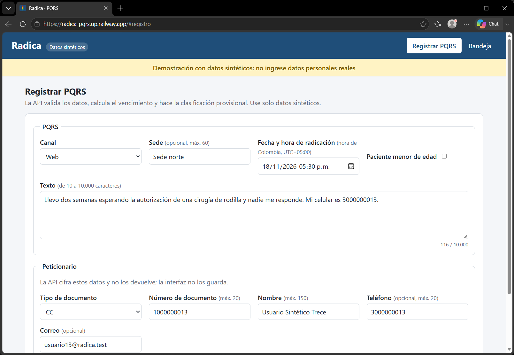
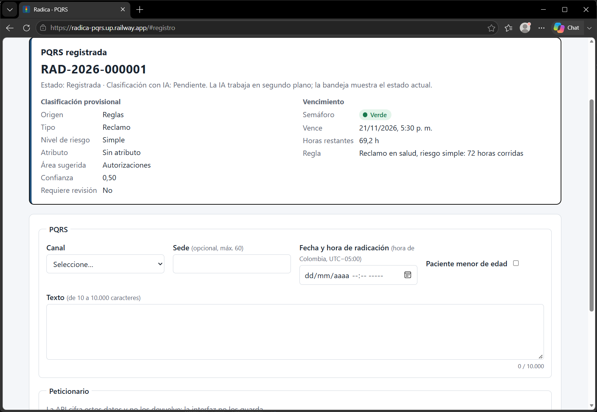
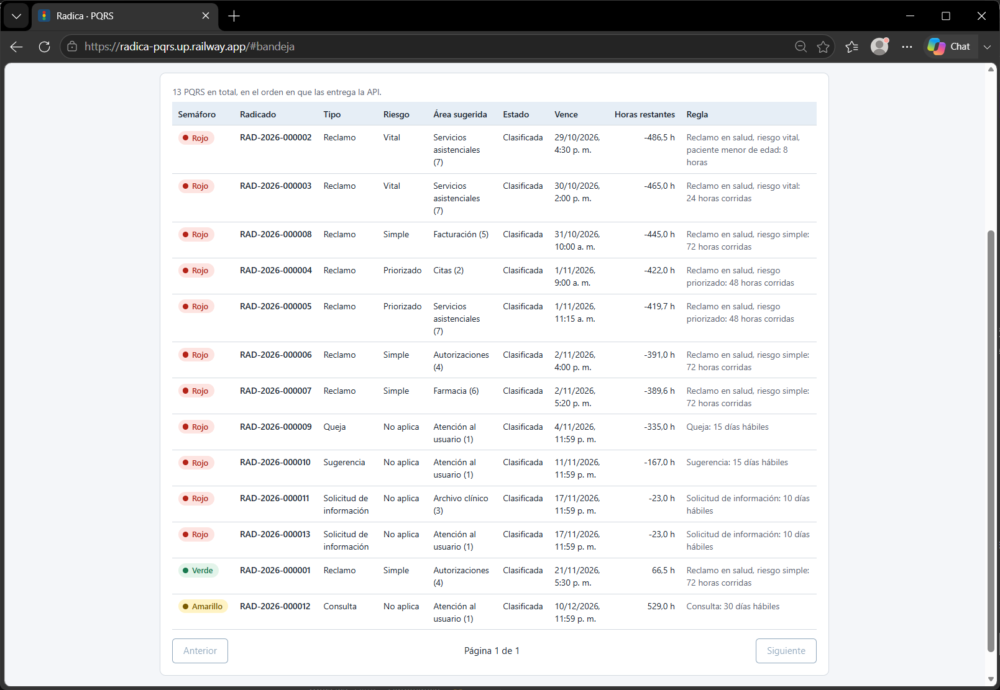
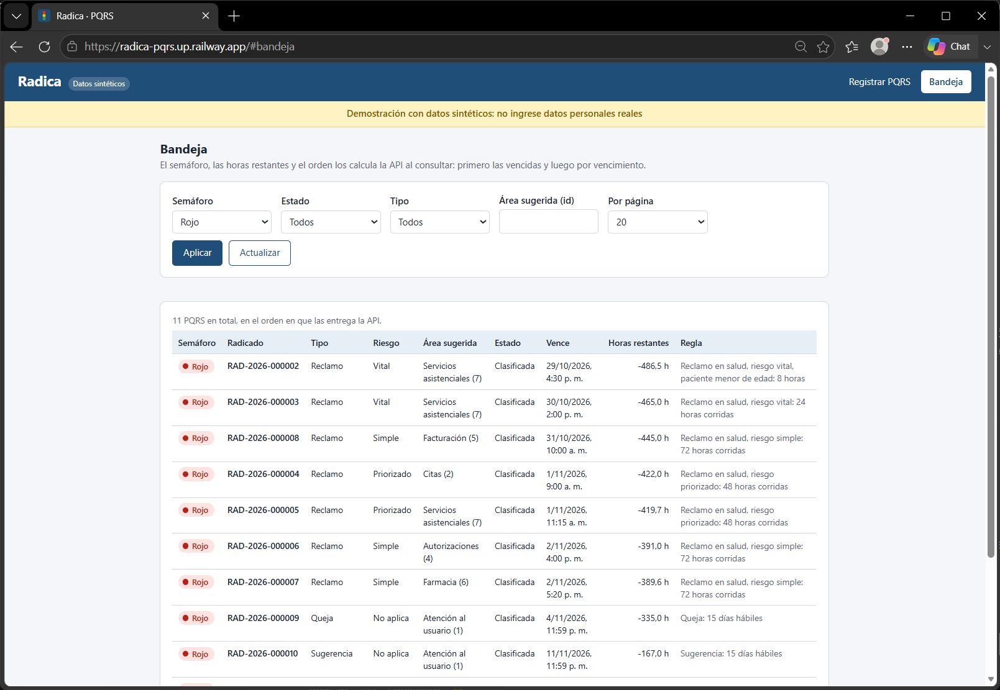
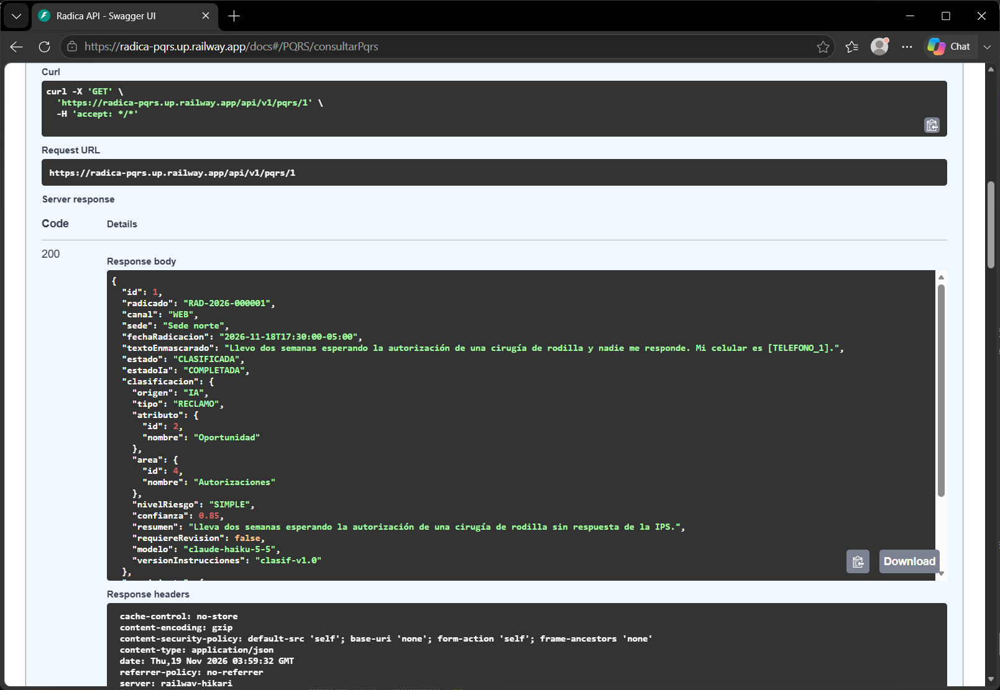
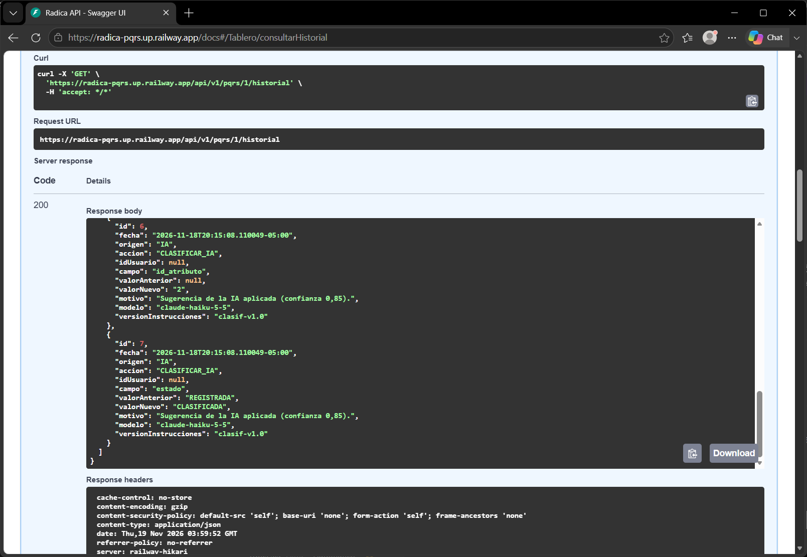
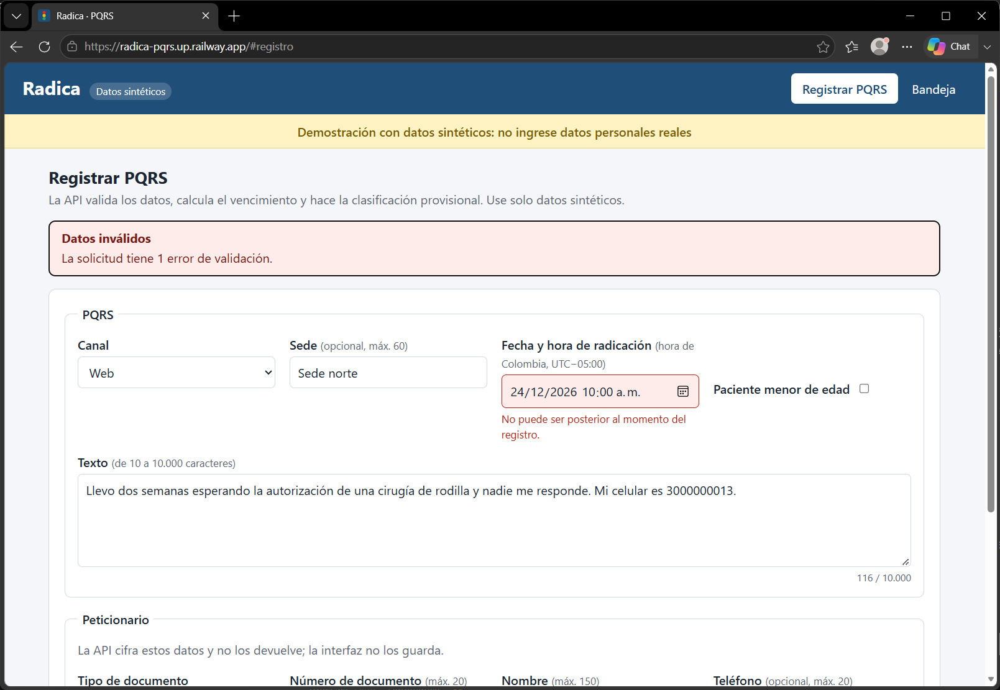
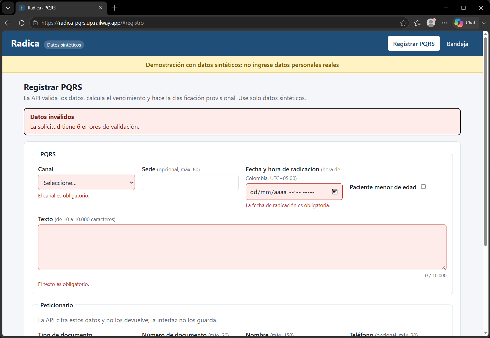

# Manual de usuario – Radica

Radica ayuda a la oficina de atención al usuario de una IPS a registrar las PQRS (peticiones, quejas, reclamos y sugerencias), a saber cuándo vence cada una y a clasificarlas con ayuda de la IA.

Este manual usa la demostración en línea: **https://radica-pqrs.up.railway.app**. Es una demostración con datos sintéticos: **no escribas datos personales reales**. No pide usuario ni contraseña, y todo lo que hagas queda a nombre del usuario de prueba «Funcionario Sintético». Las capturas son de esa misma dirección, el 18-nov-2026.

## ¿Qué puedes hacer?

- **Registrar una PQRS** con el texto y los datos del peticionario. Radica calcula su vencimiento según el término legal y la clasifica de forma provisional al instante.
- **Revisar la bandeja**: todas las PQRS con su semáforo (verde, amarillo o rojo), las horas que les quedan y filtros por semáforo, estado, tipo y área.
- **Consultar la clasificación de la IA y el historial** de cada PQRS: qué sugirió la IA, con qué confianza y cada cambio que tuvo la PQRS.

Todavía no se puede corregir la clasificación, asignar un responsable, responder la PQRS ni iniciar sesión.

## 1. Registrar una PQRS

1. Abre https://radica-pqrs.up.railway.app. Se abre la pestaña **Registrar PQRS**.
2. En el recuadro **PQRS**:
   - **Canal**: por dónde llegó (Web, Verbal, DIME, Correo, Carta, Buzón o Aplicativo de la EPS).
   - **Sede**: opcional, hasta 60 caracteres.
   - **Fecha y hora de radicación**: en hora de Colombia. No puede ser posterior al momento del registro.
   - **Paciente menor de edad**: márcala si aplica. En un reclamo de riesgo vital acorta el plazo.
   - **Texto**: lo que dice la PQRS, de 10 a 10.000 caracteres.
3. En el recuadro **Peticionario**: **Tipo de documento**, **Número de documento** (hasta 20 caracteres) y **Nombre** (hasta 150). **Teléfono** y **Correo** son opcionales.

   

4. Pulsa **Registrar PQRS**.
5. Arriba aparece **PQRS registrada** con:
   - el **radicado** (por ejemplo, RAD-2026-000001). Anótalo: lo usas en la tarea 3;
   - la **clasificación provisional**, que hacen las reglas por palabras clave (origen «Reglas»);
   - el **vencimiento**, con su semáforo, la fecha, las horas restantes y la regla del plazo.

   

La **Clasificación con IA** queda «Pendiente»: la IA trabaja en segundo plano y tarda unos segundos (tarea 3). Los datos del peticionario se guardan cifrados y no se vuelven a mostrar; la interfaz no los guarda en el navegador.

## 2. Revisar la bandeja con el semáforo

1. Pulsa **Bandeja**, arriba a la derecha.
2. Cada fila es una PQRS: semáforo, radicado, tipo, riesgo, área sugerida, estado, fecha de vencimiento, horas restantes y la regla del plazo. Las vencidas salen primero; las demás, por fecha de vencimiento.
3. Lee el semáforo:
   - **Rojo**: ya venció. Las horas restantes son negativas.
   - **Amarillo**: queda la mitad o menos del tiempo total de su plazo.
   - **Verde**: queda más de la mitad.

   

4. Para filtrar, elige **Semáforo**, **Estado** o **Tipo**, o escribe en **Área sugerida (id)** el número que aparece entre paréntesis junto al área. Pulsa **Aplicar**.

   

5. **Actualizar** vuelve a pedir la bandeja: úsalo para ver el resultado de la IA. **Por página**, **Anterior** y **Siguiente** sirven para recorrer la lista.

El semáforo y las horas restantes se calculan cada vez que abres la bandeja, así que cambian con el paso del tiempo aunque nadie toque la PQRS.

## 3. Consultar la clasificación de la IA y el historial

La interfaz todavía no tiene una pantalla de detalle. La clasificación de la IA y el historial se consultan en la documentación interactiva de la API, en el mismo navegador.

1. Saca el **id** del radicado: es el número final sin los ceros. RAD-2026-000001 tiene el id 1.
2. Abre https://radica-pqrs.up.railway.app/docs.
3. Despliega **GET /api/v1/pqrs/{id}**, pulsa **Try it out**, escribe el id y pulsa **Execute**.
4. En **Response body** revisa:
   - `estadoIa`: `PENDIENTE` (la IA todavía no responde), `COMPLETADA`, `FALLIDA` (la IA falló) u `OMITIDA` (la IA no se usó).
   - `clasificacion.origen`: `IA` si quedó vigente la sugerencia de la IA; `REGLAS` si sigue la provisional.
   - `clasificacion.tipo`, `nivelRiesgo`, `area`, `confianza` (de 0 a 1), `resumen`, `requiereRevision` y `modelo`.
   - `textoEnmascarado`: el texto tal como lo recibió la IA.

   

5. Para el historial, despliega **GET /api/v1/pqrs/{id}/historial** y repite **Try it out**, el id y **Execute**. Cada evento trae la fecha, quién lo hizo (`PERSONA`, `SISTEMA` o `IA`), la acción, el campo, el valor anterior y el nuevo, y el motivo. Los de la IA traen además el modelo y la versión de las instrucciones.

   

Atajo: también puedes abrir la dirección directamente, por ejemplo https://radica-pqrs.up.railway.app/api/v1/pqrs/1 o https://radica-pqrs.up.railway.app/api/v1/pqrs/1/historial.

## Función de IA: qué hace y sus límites

Qué hace:

- Unos segundos después del registro, Radica envía a Claude Haiku 5.5 (`claude-haiku-5-5`) **solo el texto enmascarado**: la cédula, el teléfono, el correo y el número de historia clínica quedan como marcas (`[CEDULA_1]`, `[TELEFONO_1]`, `[CORREO_1]`, `[HC_1]`). Antes de enviarlo verifica que no quede ningún dato del peticionario; si queda alguno, no llama a la IA.
- La IA **sugiere** el tipo, el área, el atributo de calidad, el nivel de riesgo en salud, una confianza de 0 a 1 y un resumen de una línea.
- La IA **nunca calcula el plazo**. El vencimiento lo calculan reglas, con la tabla de términos legales y los festivos de Colombia. Si la IA cambia el tipo o sube el riesgo, las reglas recalculan el plazo.
- La IA puede subir el riesgo o acortar el plazo, nunca bajarlo ni alargarlo. Si su sugerencia lo haría, no se aplica y la PQRS pasa a **Requiere revisión**.
- Si la confianza es menor de 0,75, la sugerencia se aplica, pero la PQRS pasa a **Requiere revisión**.
- **Si la IA falla** (no responde, da error o entrega una respuesta inválida después de los reintentos), queda la clasificación por reglas y la PQRS pasa a **Requiere revisión**.

Sus límites:

- **Los nombres y las direcciones dentro del texto todavía no se enmascaran** (PB-05, issue #18): el nombre de un familiar, de un médico o una dirección llegan a la IA tal cual. Solo el nombre del peticionario se oculta (`[NOMBRE_1]`), y solo si aparece escrito igual que en el campo **Nombre**.
- Es una sugerencia y puede equivocarse. Todavía no hay una pantalla para corregirla (PB-08, issue #8).
- No redacta respuestas ni responde la PQRS.
- Cada llamada tiene un costo, que Radica registra con sus tokens. En esta demostración, 13 clasificaciones costaron USD 0,004256.

## Problemas frecuentes

**«No puede ser posterior al momento del registro.» al registrar.** La fecha y hora de radicación está en el futuro. La API responde 400 y el mensaje sale debajo del campo. Escribe la fecha y la hora en que llegó la PQRS, en hora de Colombia.

**Mensajes como «El canal es obligatorio.» debajo de varios campos.** Falta algún dato obligatorio: canal, fecha y hora de radicación, texto, tipo de documento, número de documento o nombre. Complétalos y pulsa **Registrar PQRS** otra vez. Si el texto tiene menos de 10 caracteres, también lo rechaza.

**La clasificación con IA dice «Pendiente».** Es normal durante unos segundos: la IA trabaja en segundo plano y revisa las PQRS nuevas cada 5 segundos. Pulsa **Actualizar** en la bandeja o vuelve a consultar la PQRS (tarea 3). Mientras tanto vale la clasificación provisional por reglas, y el vencimiento ya está calculado.

**La PQRS dice «Requiere revisión».** Una persona debe revisar la clasificación. Pasa cuando:

- la confianza de la IA es menor de 0,75;
- la IA sugirió algo que bajaría el riesgo o alargaría el plazo, y no se aplicó;
- la IA marcó un riesgo vital o priorizado en una PQRS que no es un reclamo;
- la IA falló o no se usó, y quedó la clasificación por reglas.

El motivo exacto está en el historial (tarea 3, columna `motivo`). La corrección desde la interfaz todavía no existe (PB-08).

**«Sin conexión» o «Error 502 · La API no respondió con Problem Details.»** La interfaz no llegó a la API: no hay red, o la API está caída o reiniciándose (por ejemplo, durante un despliegue). Abre https://radica-pqrs.up.railway.app/health: si no responde `{"estado":"ok"}`, espera un minuto y vuelve a intentar.
